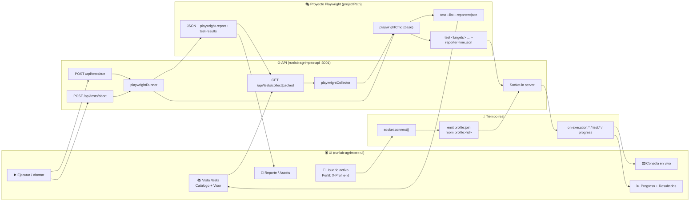
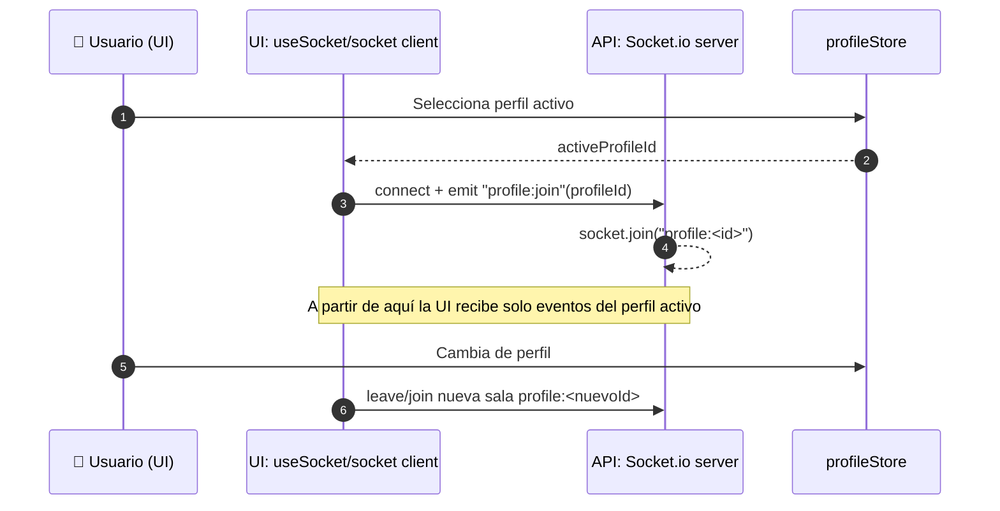
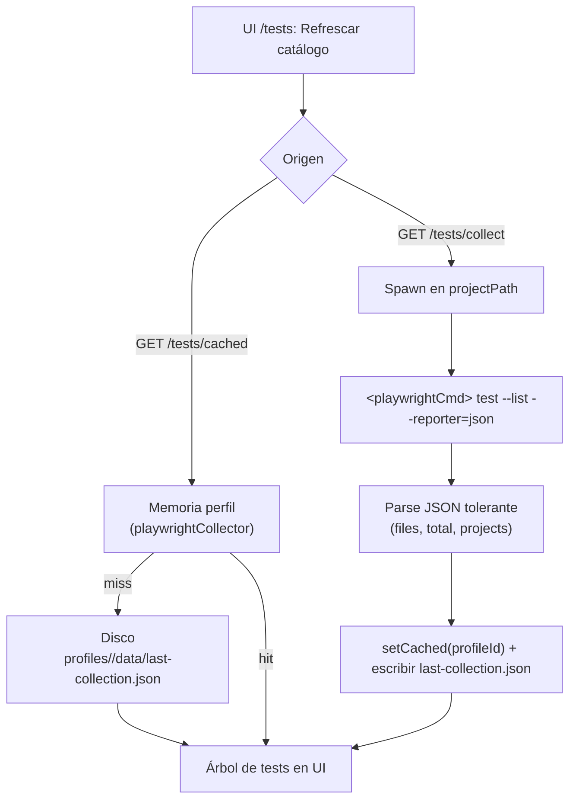
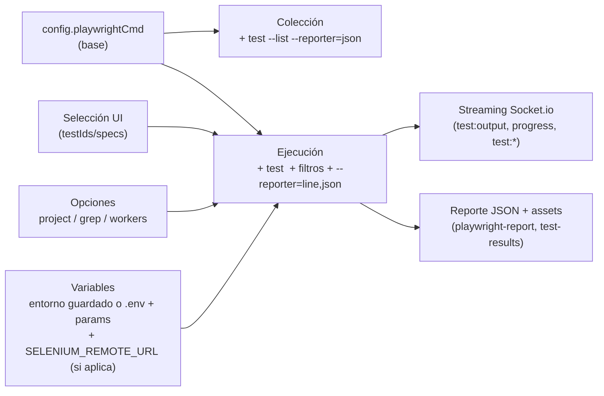
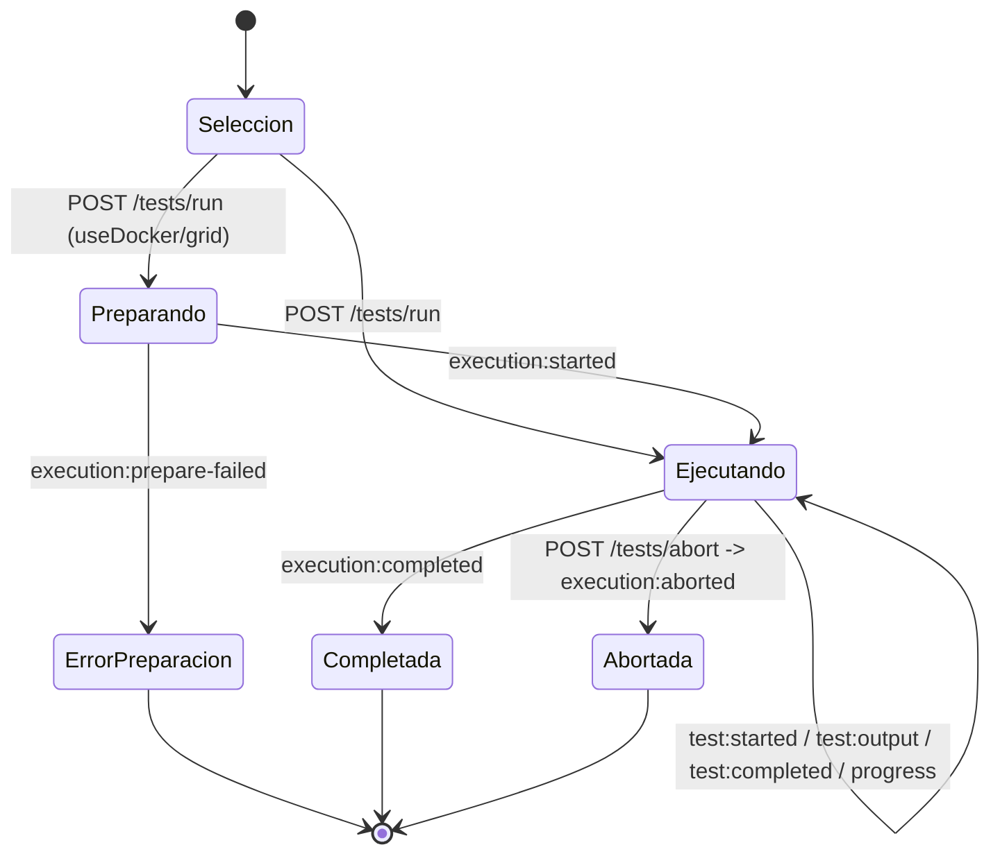
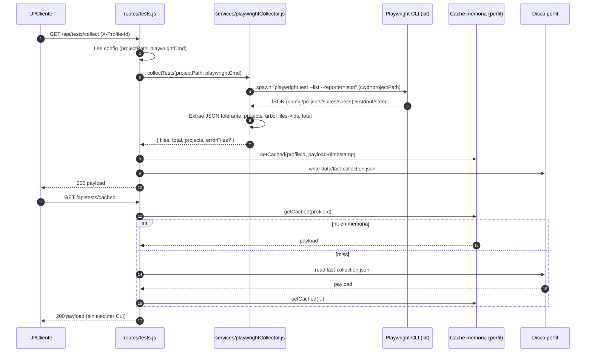
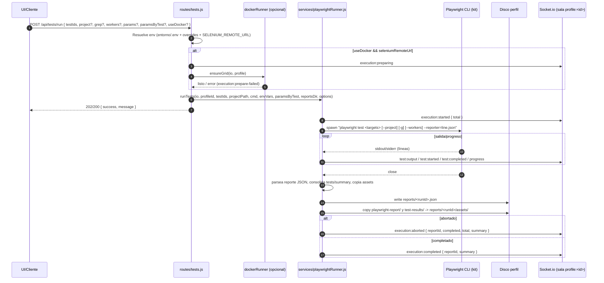
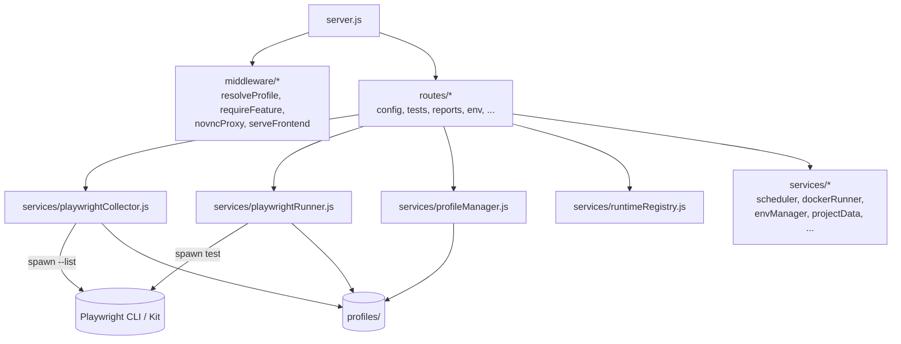
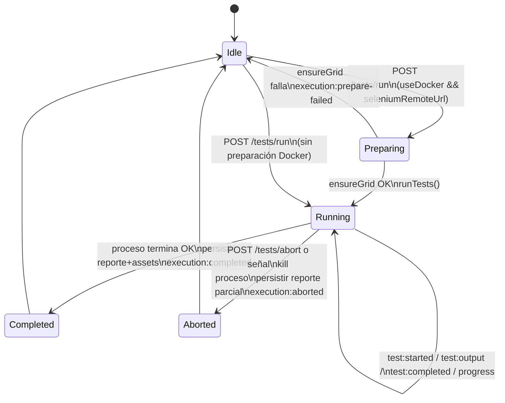

# RunLab Agrimpex — API

Backend del dashboard QA **RunLab Agrimpex**. Expone una **API REST** y un canal **Socket.io** para: gestionar perfiles/proyectos, colectar y ejecutar tests de automatización (base actual: **Playwright**), transmitir progreso en vivo y persistir reportes/artefactos.

> **Origen:** adaptación de [QADash backend](https://github.com/hramses1/dash-backend) (MIT, © hramses1). Se mantiene la filosofía de trabajo por perfiles y el contrato REST + Socket.io, adaptado al ecosistema Playwright de Agrimpex.  
> **Frontend hermano:** `runlab-agrimpex-ui` (React/Vite), servido por este backend en producción.  
> **Kit objetivo (AUT/suite):** `playwright-kit-profesional` (suite E2E Playwright; p.ej. 4 projects `chromium`, `inbond`, `air-freight`, `logistic`).

---

## Índice
- [Estado actual](#estado-actual)
- [Arquitectura rápida](#arquitectura-rápida)
- [Requisitos](#requisitos)
- [Ejecución manual](#ejecución-manual)
- [Ejecución con Docker](#ejecución-con-docker)
- [Ventaja de la imagen Playwright](#ventaja-de-la-imagen-playwright)
- [Configuración](#configuración)
- [Conceptos clave (onboarding)](#conceptos-clave-onboarding)
- [Onboarding en vivo: Socket.io y ejecuciones Playwright](#onboarding-en-vivo-socketio-y-ejecuciones-playwright)
- [Estructura del proyecto](#estructura-del-proyecto)
- [API REST (resumen)](#api-rest-resumen)
- [Eventos Socket.io](#eventos-socketio)
- [Almacenamiento y persistencia (sin base de datos)](#almacenamiento-y-persistencia-sin-base-de-datos)
- [Pruebas y desarrollo](#pruebas-y-desarrollo)
- [Seguridad](#seguridad)
- [Solución de problemas](#solución-de-problemas)
- [OpenSpec y convenciones](#openspec-y-convenciones)
- [Licencia](#licencia)

---

## Estado actual

- **Runner de tests:** migrado a Playwright (`services/playwrightCollector.js`, `services/playwrightRunner.js`) con paridad de contrato de eventos (`execution:*`, `test:*`, `progress`) y persistencia de reportes/assets. Colecta con `npx playwright test --list --reporter=json`, ejecuta con `npx playwright test ... --reporter=line,json`.
- **Compatibilidad:** `playwrightCmd` es el campo preferido; `pytestCmd` se mantiene **deprecado** con lectura tolerante (rutas/scheduler/config). Existen módulos legacy `pytestRunner.js`/`testCollector.js` para compatibilidad con pruebas/consumidores históricos.
- **Validación:** colección verificada contra el kit real (ej.: 713 tests, 93 archivos, 4 projects); suite del backend **27/27** en `node --test`. La ejecución E2E completa depende de que el AUT (`localhost:5000` / `localhost:8990`) esté disponible.
- **Detalles de verificación:** `openspec/changes/playwright-runner/README.md` y `openspec/changes/playwright-runner/tasks.md`.

---

## Arquitectura rápida

```
runlab-agrimpex-ui (React, dev :5173 / dist en prod)
        │  HTTP /api  +  Socket.io (/socket.io)
        ▼
runlab-agrimpex-api (Express + Socket.io, :3001)
        │
        ├─ Perfiles (workspace por proyecto) ──► profiles/<id>/...
        ├─ Collector (Playwright --list) ─────► árbol de tests + caché
        ├─ Runner (Playwright test) ──────────► eventos en vivo + reportes/assets
        └─ Módulos opcionales: env, reports, docker, schedules, data, errors, automation, system
                │
                ▼
      Proyecto de automatización (kit Playwright)  ──►  AUT (Angular :5000 / API :8990)
```

- **Multi-perfil:** cada request API (salvo admin de perfiles/sistema) se resuelve con `X-Profile-Id` (`middleware/resolveProfile.js`) y opera sobre el workspace de ese perfil.
- **Tiempo real:** el cliente se une a la sala `profile:<id>` (`profile:join`) y recibe solo eventos de ese perfil.
- **Producción:** el backend puede servir el build del frontend (`middleware/serveFrontend.js`, configurable por `RUNLABQA_DIST_DIR`).

---

## Requisitos

| Herramienta | Uso | Obligatoria |
|---|---|---|
| Node.js 20+ (recomendado 22/24; Docker usa Node 24) | Ejecutar API y tooling | Sí |
| npm | Dependencias y scripts | Sí |
| Git | Operaciones de automatización/actualización (según uso) | Recomendada |
| Proyecto Playwright (kit) + `npx playwright`/Node deps del kit | Colección y ejecución | Sí para correr tests |
| AUT disponible (p.ej. `localhost:5000` y `localhost:8990`) | Ejecución E2E real | Sí para runs reales |
| Docker + Docker Compose | Grid Selenium / flujos dockerizados (opcional) | No |
| Python/venv/pytest | Solo para flujos legacy de automatización heredados | No (según escenario) |

> El backend **no** incluye la suite de tests: apunta a un `projectPath` (kit Playwright) configurado por perfil.

---

## Ejecución manual

Modo recomendado para **desarrollar la API o depurarla con Playwright instalado en el host**. No necesita Docker: Node/npm y el kit de tests corren como procesos locales.

### 1) Requisitos

| Herramienta | Versión recomendada | Para qué |
|---|---|---|
| Node.js | 22 (mínimo 20) | Servidor Express + Socket.io y tooling |
| npm | el que traiga Node | Instalar dependencias con `package-lock.json` |
| Git | cualquiera | Módulos de automatización/self-update |
| Kit Playwright + AUT | `@playwright/test@1.62.1` en el kit | Colección y ejecución real de tests |

### 2) Instalar dependencias

```bash
cd runlab-agrimpex-api
npm ci                 # reproducible: usa package-lock.json
```

### 3) Configurar el entorno (opcional)

```bash
# Por defecto RUNLABQA_DATA_DIR es la raíz del repo (profiles/ y reportes/).
# Si prefieres aislar los datos de runtime:
export RUNLABQA_DATA_DIR="$PWD/.runtime"

# Si quieres que esta API sirva el build de la UI (producción local):
# export RUNLABQA_DIST_DIR="../runlab-agrimpex-ui/dist"

# Cambiar puerto (recuerda alinear el proxy de la UI):
# export PORT=3001
```

Al arrancar se aplica la migración de perfiles (`services/profileMigration.js`) y se crea **"Perfil 1"** si aún no existe ninguno. No hay base de datos: todo se persiste como JSON/artefactos en `RUNLABQA_DATA_DIR` (ver [Almacenamiento](#almacenamiento-y-persistencia-sin-base-de-datos)).

### 4) Arrancar la API

```bash
npm run dev    # nodemon: recarga al cambiar archivos
# o bien
npm start      # node server.js, sin recarga
```

Puerto por defecto: **`3001`**. Swagger UI: <http://localhost:3001/api/docs/>.

### 5) Arrancar la UI en paralelo (otra terminal)

```bash
cd ../runlab-agrimpex-ui
npm ci
npm run dev            # http://localhost:5173
```

En desarrollo no hay que definir `VITE_API_URL`: `vite.config.ts` hace proxy de `/api` y `/socket.io` hacia `http://localhost:3001`. Si la API está en otro host/puerto, ajusta ese proxy o define `VITE_API_URL`/`VITE_SOCKET_URL` en `runlab-agrimpex-ui/.env` y reinicia Vite.

### 6) Smoke test

```bash
curl -fsS http://localhost:3001/api/openapi.json | head -c 160; echo
curl -i http://localhost:3001/api/profile-admin
curl -H "X-Profile-Id: perfil-1" http://localhost:3001/api/config
```

Respuesta esperada del primer comando: `{"openapi":"3.0.3","info":{"title":"RunLab Agrimpex API"...}}`.

### 7) Preparar Playwright en el host (para ejecutar tests)

La API **no incluye la suite**. Configura el perfil desde la UI (**Ajustes > Proyecto**):

- `projectPath`: ruta absoluta al kit, p. ej. `/home/potlitel/Trabajo/EICMA/Agrimpex/playwright-kit-profesional`.
- `playwrightCmd`: `npx playwright` (comando **base**, sin `test`).
- `envPath` y variables del AUT según corresponda (`localhost:5000` / `localhost:8990`).

Instala dependencias y navegadores **en el kit**, no en la API:

```bash
cd /ruta/a/playwright-kit-profesional
npm ci
npx playwright install
# en Linux/CI sin librerías del sistema: npx playwright install --with-deps
```

Después, en **Tests**, pulsa **Actualizar** para recolectar el catálogo y lanza una corrida pequeña. En modo manual los navegadores son los del host, así que la imagen Docker de Playwright no interviene.

### 8) Servir el build de la UI desde la API (producción local)

```bash
cd ../runlab-agrimpex-ui && npm run build
cd ../runlab-agrimpex-api
RUNLABQA_DIST_DIR=../runlab-agrimpex-ui/dist npm start
# UI + API en http://localhost:3001
```

> Para detener: `Ctrl+C` en cada terminal. Antes de usar Docker, asegúrate de liberar `3001` (y `5173` si aplica).

---

## Ejecución con Docker

Levanta **API + UI** como stack desde el **repo de la UI** (`qa-dashboard/runlab-agrimpex-ui/`), donde ahora vive el `docker-compose.yml`. No necesitas Node/npm en el host: todo el build ocurre dentro de las imágenes.

### 1) Arranque estándar

```bash
cd /home/potlitel/Trabajo/EICMA/Agrimpex/qa-dashboard/runlab-agrimpex-ui
cp .env.example.stack .env  # opcional: los defaults ya funcionan
docker compose up -d --build
docker compose ps
```

> ⚠️ El puerto `3000` pertenece al stack DAM de referencia (`dam-frontend`). Este stack publica su UI en **`3002`**. No hace falta detener DAM.

| Servicio | Contenedor | URL desde el host | Dentro de la red |
|---|---|---|---|
| `runlabqa-api` | `runlabqa-api` | <http://localhost:3001> · Swagger `/api/docs/` | `runlabqa-api:3001` |
| `runlabqa-ui` | `runlabqa-ui` | <http://localhost:3002> | `runlabqa-ui:3000` |

La UI arranca solo después de que la API pase el **healthcheck** (`GET /api/openapi.json` en `:3001`). El `Dockerfile` de la API usa `node:22-alpine` por defecto (ya en caché), instala con `npm ci --omit=dev`, crea `/data` y corre como uid `1000:1000`. La UI usa `Dockerfile.npm` multi-stage y `serve -s dist`.

### 2) Verificación

```bash
docker compose ps
curl -i http://localhost:3001/api/openapi.json     # 200
curl -i http://localhost:3002/                     # 200
docker compose logs -f runlabqa-api
```

Resultado ya verificado en este equipo:

```text
runlabqa-api   Up (healthy)   0.0.0.0:3001->3001/tcp
runlabqa-ui    Up             0.0.0.0:3002->3000/tcp
HTTP 200 /api/openapi.json  ·  HTTP 200 /  ·  <title>RunLab Agrimpex — QA Dashboard</title>
```

### 3) Variables y persistencia

- **En tiempo de ejecución** (API): `PORT`, `RUNLABQA_DATA_DIR=/data`, `TZ`, `RUNLABQA_NOVNC_*`, `UPDATE_TOKEN`. Se definen en `docker-compose.yml` / `.env` del repo de la UI.
- **En tiempo de build** (UI): `VITE_API_URL` y `VITE_SOCKET_URL` se **hornean en el bundle**. Deben ser alcanzables desde el **navegador**, no desde el contenedor. Cambiarlos exige reconstruir la UI:

```bash
docker compose up -d --build runlabqa-ui
```

- Persistencia: volumen nombrado **`runlabqa-data`** en `/data` **+ bind mount** de `../runlab-agrimpex-api/profiles` en `/data/profiles`. `.dockerignore` excluye `profiles/` de la imagen, pero el bind mount lo reincorpora desde el host.

```bash
docker compose down       # detiene y conserva todo
docker compose down -v    # borra runlabqa-data, PERO NO los perfiles del host
```

### 4) Módulos que necesitan el host

El kit Playwright **ya está montado de forma activa** en la misma ruta absoluta que aparece en los perfiles guardados, así que `projectPath` sigue siendo válido:

```yaml
- ${PLAYWRIGHT_KIT_DIR:-/home/potlitel/Trabajo/EICMA/Agrimpex/playwright-kit-profesional}:${PLAYWRIGHT_KIT_DIR:-/home/potlitel/Trabajo/EICMA/Agrimpex/playwright-kit-profesional}
```

> No lleva `:ro` porque las corridas escriben `test-results/` y `playwright-report/` dentro del proyecto. Si solo vas a recolectar el catálogo (`--list`), puedes añadir `:ro`.

Para el módulo `/api/docker`, descomenta en `docker-compose.yml`:

```yaml
- /var/run/docker.sock:/var/run/docker.sock
- /usr/bin/docker:/usr/bin/docker:ro
```

- Sin el socket/CLI, el módulo `/api/docker` no puede controlar el daemon del host.
- El kit **no** se incluye en la imagen: sus `node_modules` deben existir en el host.
- El AUT en `localhost` del host se alcanza como `host.docker.internal` (ya configurado con `extra_hosts: host-gateway`).

### 5) Conservar los perfiles previos a la dockerización

Los perfiles que ya existían antes del cambio viven en `runlab-agrimpex-api/profiles/` y el compose los monta en `/data/profiles`. Como `profileManager` resuelve `PROFILES_DIR = path.join(RUNLABQA_DATA_DIR, 'profiles')`, la API los lee directamente: **no hay que importarlos ni recrearlos**.

```bash
docker compose up -d runlabqa-api
curl -fsS http://localhost:3001/api/profile-admin
```

Perfiles esperados: `perfil-1`, `perfil-qa-test-2`, `perfil-1-copia`, `alain`, `jorge` (5 en total). Cada `config.json` conserva su `projectPath`, `playwrightCmd`, entornos, schedules, caché y reportes.

> El `perfil-1` que se creó automáticamente dentro del volumen `runlabqa-data` queda **oculto** bajo el bind mount; el que manda es `runlab-agrimpex-api/profiles/perfil-1`. Como el mount apunta al repo, `docker compose down -v` ya no borra estos perfiles.

### 6) Ciclo de vida y equivalente sin Compose

```bash
docker compose logs -f runlabqa-api
docker compose restart runlabqa-api
docker compose exec runlabqa-api sh
docker compose up -d --build        # reconstruir todo
```

Equivalente manual (Compose sigue siendo preferible por healthcheck, red y `depends_on`).
Ejecuta estos comandos desde `qa-dashboard/`, la carpeta que contiene ambos repos:

```bash
docker build -f runlab-agrimpex-api/Dockerfile -t runlabqa-agrimpex-api runlab-agrimpex-api
docker run -d --name runlabqa-api -p 3001:3001 -v runlabqa-data:/data \
  --add-host=host.docker.internal:host-gateway runlabqa-agrimpex-api

docker build -f runlab-agrimpex-ui/Dockerfile.npm -t runlabqa-agrimpex-ui \
  --build-arg VITE_API_URL=http://localhost:3001/api \
  --build-arg VITE_SOCKET_URL=http://localhost:3001 runlab-agrimpex-ui
docker run -d --name runlabqa-ui -p 3002:3000 runlabqa-agrimpex-ui
```

Ver [guía completa de onboarding Docker](../runlab-agrimpex-ui/docs/ONBOARDING_DOCKER.md).

---

## Docker Compose: referencia detallada

El stack completo se define en **`docker-compose.yml`**, dentro del repo de la UI (`runlab-agrimpex-ui/`), junto con `.env.example.stack` y `docs/ONBOARDING_DOCKER.md`. La guía definitiva está en [RunLab Agrimpex — Orquestación Docker](<../runlab-agrimpex-ui/RunLab Agrimpex — Orquestación Docker.md>); aquí se desmenuza lo que afecta a la API.

### Servicio `runlabqa-api`

| Bloque del YAML | Valor / efecto |
|---|---|
| `build.context` | `../runlab-agrimpex-api`. Su `.dockerignore` excluye `node_modules`, `profiles/`, reportes y secretos. |
| `build.dockerfile` | `Dockerfile`: instala con `npm ci --omit=dev`, crea `/data`, corre como uid `1000:1000` y usa healthcheck en `/api/openapi.json`. |
| `build.args.API_BASE_IMAGE` | `${API_BASE_IMAGE:-node:22-alpine}`. Base opcional Playwright; requiere `--build`. |
| `build.args.HTTP_PROXY` / `HTTPS_PROXY` / `NO_PROXY` | Se pasan a `npm ci` durante el build; requieren `--build`. |
| `image` | `runlabqa-agrimpex-api` (tag local resultante). |
| `container_name` | `runlabqa-api` (nombre fijo para `docker logs`, `exec`, etc.). |
| `restart` | `unless-stopped`. |
| `environment.PORT` | `3001`, fijo para que coincida con healthcheck y `ports`. |
| `environment.RUNLABQA_DATA_DIR` | `/data`, fijo para que coincida con el volumen. |
| `environment.RUNLABQA_NOVNC_HOST` / `RUNLABQA_NOVNC_PORT` | `${...:-host.docker.internal}` / `${...:-7900}`. Runtime. |
| `environment.TZ` | `${TZ:-America/Argentina/Buenos_Aires}`. Afecta a `services/scheduler.js`. |
| `environment.UPDATE_TOKEN` | `${UPDATE_TOKEN:-}`. Vacío deshabilita `/api/system/update` con 503. |
| `ports` | `"${API_PORT:-3001}:3001"`. |
| `volumes[0]` | `runlabqa-data:/data` → persistencia general. |
| `volumes[1]` | `${RUNLABQA_PROFILES_DIR:-../runlab-agrimpex-api/profiles}:/data/profiles` → perfiles previos a Docker; tiene prioridad sobre el volumen. |
| `volumes[2]` | `${PLAYWRIGHT_KIT_DIR:-/home/.../playwright-kit-profesional}` montado en **la misma ruta**, para no editar `projectPath`. Escribible por las corridas. |
| `extra_hosts` | `host.docker.internal:host-gateway` → AUT del host accesible desde el contenedor. |
| `networks` | `runlabqa-network` (bridge privada compartida con la UI). |

`profileManager.js` resuelve `PROFILES_DIR = path.join(process.env.RUNLABQA_DATA_DIR || '..', 'profiles')`, de modo que el bind mount en `/data/profiles` es exactamente lo que la API lee. Esto es lo que conserva los 5 perfiles (`perfil-1`, `perfil-qa-test-2`, `perfil-1-copia`, `alain`, `jorge`).

### Cómo funcionan los `.env` en este YAML

Resumen rápido: Compose lee el **`.env` del repo de la UI** (junto al compose) y sustituye `${VAR}`; si no existe, usa el default de `${VAR:-default}`. La prioridad es: **variable exportada en la shell → `.env` → default del YAML**.

```bash
# .env (repo de la UI, NO versionado; plantilla: .env.example.stack)
API_PORT=3001
UI_PORT=3002
RUNLABQA_PROFILES_DIR=../runlab-agrimpex-api/profiles
TZ=America/Argentina/Buenos_Aires
```

Puntos clave:

1. **`.env` del stack ≠ `.env` del backend.** El `.env` de `runlab-agrimpex-ui/` lo consume Compose; el de `runlab-agrimpex-api/` (si lo usaras en ejecución manual) lo consumes tú al exportar variables. Dentro del contenedor las variables vienen de `environment:` en el compose.
2. **`build-arg` vs `runtime`.** `API_BASE_IMAGE`, proxies, `VITE_API_URL` y `VITE_SOCKET_URL` se graban en la imagen ⇒ `up -d --build`. `PORT`, `TZ`, `RUNLABQA_NOVNC_*`, `UPDATE_TOKEN`, puertos y montajes son runtime ⇒ basta `up -d` para recrear.
3. **Sintaxis.** Usa `KEY=VAL` sin espacios ni `export`; comentarios con `#`. Nunca subas `.env`: está en `.gitignore` del repo de la UI.
4. **Override puntual.** `API_PORT=3011 docker compose up -d` gana sobre el `.env`.
5. **Montajes relativos.** `RUNLABQA_PROFILES_DIR=../runlab-agrimpex-api/profiles` se resuelve relativo al `docker-compose.yml`, no al directorio actual.

### Variables que conviene conocer

| Variable | Default | Fase | Efecto |
|---|---|---|---|
| `API_PORT` | `3001` | runtime | Puerto host de la API. |
| `API_BASE_IMAGE` | `node:22-alpine` | build | Base de la imagen; opcional Playwright. |
| `RUNLABQA_DATA_DIR` | `/data` | runtime | Raíz de persistencia (fija en compose). |
| `RUNLABQA_PROFILES_DIR` | `../runlab-agrimpex-api/profiles` | runtime | Origen del bind mount de perfiles. |
| `PLAYWRIGHT_KIT_DIR` | ruta absoluta del kit | runtime | Kit montado en su ruta original. |
| `RUNLABQA_NOVNC_HOST` / `_PORT` | `host.docker.internal` / `7900` | runtime | Proxy noVNC. |
| `TZ` | `America/Argentina/Buenos_Aires` | runtime | Schedules. |
| `UPDATE_TOKEN` | vacío | runtime | Habilita self-update. |
| `HTTP_PROXY` / `HTTPS_PROXY` / `NO_PROXY` | vacíos | build | npm dentro del build. |

### Migración desde `qadash-*`

Los recursos antiguos se renombraron a `runlabqa-*`. Si quedaron contenedores/volúmenes viejos, sigue [la sección de migración de la guía de orquestación](<../runlab-agrimpex-ui/RunLab Agrimpex — Orquestación Docker.md#12-migración-desde-los-antiguos-nombres-qadash->). Los perfiles nunca estuvieron en el volumen: viven en `profiles/` y ahora se montan desde el host.

---

## Ventaja de la imagen Playwright

`mcr.microsoft.com/playwright:v1.62.1-noble` **no es necesaria para levantar el dashboard**: REST y Socket.io funcionan con `node:22-alpine`. Es una **base opcional de la API** pensada para cuando quieras ejecutar Playwright **dentro del contenedor**.

| Base | ¿Descarga nueva? | Dashboard REST/WS | Playwright dentro del contenedor |
|---|---|---|---|
| `node:22-alpine` (default) | No, ya está en caché | ✅ | ⚠️ Sin navegadores ni libs del sistema |
| `mcr.microsoft.com/playwright:v1.62.1-noble` | Sí (≈ 1.7 GB) | ✅ | ✅ Listo para usar |

**Ventajas concretas:**

1. **Versión alineada:** el tag `v1.62.1` coincide con `@playwright/test@1.62.1` del kit. Playwright exige que la versión de los navegadores coincida con la del paquete; si no, falla con `Executable doesn't exist at ...`.
2. **Navegadores + dependencias del sistema incluidos:** Chromium, Firefox y WebKit con sus libs en Ubuntu `noble` (glibc). En Alpine (musl), Firefox/WebKit no están soportados y habría que instalar decenas de paquetes del sistema.
3. **Build reproducible y más rápido tras el primer pull:** evita repetir `npx playwright install --with-deps` en cada reconstrucción, algo costoso detrás de proxy corporativo. También trae Node y `git`.
4. **Paridad con CI y con la imagen oficial de Microsoft:** menos diferencias entre "funciona en mi máquina" y el pipeline.
5. **Compatible con el mismo `Dockerfile`:** el uid `1000` existe como `node` en Alpine y como `pwuser` en la imagen Playwright; no hay que cambiar permisos de `/data`.

**Cómo activarla** (elige una de estas dos opciones):

```bash
# Opción A: persistente, recomendada (repo de la UI)
echo 'API_BASE_IMAGE=mcr.microsoft.com/playwright:v1.62.1-noble' >> .env
docker compose up -d --build runlabqa-api

# Opción B: puntual
docker compose build runlabqa-api \
  --build-arg API_BASE_IMAGE=mcr.microsoft.com/playwright:v1.62.1-noble
docker compose up -d runlabqa-api
```

> Si después ejecutas `docker compose up -d --build` sin el `API_BASE_IMAGE` en `.env`, Compose reconstruirá con `node:22-alpine`. El kit ya está montado en su ruta original (ver [Conservar los perfiles](#5-conservar-los-perfiles-previos-a-la-dockerización)), así que no hay que cambiar `projectPath`. Si tus tests usan un grid Selenium remoto (`SELENIUM_REMOTE_URL`), puedes quedarte con Alpine y no descargar esta imagen.

---

## Configuración

### Variables de entorno (backend)

| Variable | Default | Descripción |
|---|---|---|
| `PORT` | `3001` | Puerto HTTP/WS |
| `RUNLABQA_DATA_DIR` | raíz del backend | Directorio base de datos runtime (perfiles/reportes) |
| `RUNLABQA_DIST_DIR` | `../runlab-agrimpex-ui/dist` | Ruta del build del frontend a servir |
| `RUNLABQA_FRONTEND_DIR` | `../runlab-agrimpex-ui` | Repo frontend (auto-update) |
| `RUNLABQA_NOVNC_HOST` | `127.0.0.1` | Host noVNC (proxy) |
| `RUNLABQA_NOVNC_PORT` | `7900` | Puerto noVNC |
| `UPDATE_TOKEN` | *(vacío)* | Token para `/api/system/update` (sin él, el endpoint queda deshabilitado/503) |

> Si cambias `PORT`, alinea el proxy de la UI (`runlab-agrimpex-ui/vite.config.ts`).

### Configuración por perfil (`profiles/<id>/config.json`)

| Campo | Descripción |
|---|---|
| `projectPath` | Ruta absoluta al proyecto de automatización (kit Playwright) |
| `envPath` | Ruta al `.env` del proyecto |
| `playwrightCmd` | Comando base Playwright (recomendado, ej. `npx playwright`) |
| `pytestCmd` | **Deprecado** (compatibilidad/tolerancia legacy) |
| `seleniumRemoteUrl` | URL de Selenium/Grid remoto (opcional; se inyecta como `SELENIUM_REMOTE_URL`) |
| `txtFolderPath` | Carpeta de datos `.txt` (módulo `txtData`) |
| `jsonDataPath` | Carpeta de datos JSON (módulo `jsonData`) |
| `errorImagesPath` | Carpeta de evidencias de error (módulo `errorImages`) |
| `evidence` | (Opcional) Configuración de evidencias de ejecución Playwright; ver detalle abajo |

Ejemplos de referencia: `config.example.json`, `automation-config.example.json`.

#### Evidencias de ejecución (Playwright) y foto por reporte

Permite controlar la captura de evidencias por perfil y disponer de una imagen de vista previa por reporte en el historial (independiente de si la prueba pasó o falló), configurable desde **Ajustes > Proyecto y rutas > Evidencias de ejecución (Playwright)** en la UI.

**Configuración (`config.evidence`):**

| Campo | Valores | Descripción |
|---|---|---|
| `screenshot` | `always` \| `only-on-failure` \| `off` | Política de capturas. `always` fuerza captura en todos los tests (incluidos pasados). Si no se define, se respeta el `playwright.config` del proyecto. |
| `video` | `on` \| `off` \| `retain-on-failure` \| `on-first-retry` | Grabación de video. |
| `trace` | `on` \| `off` \| `retain-on-failure` \| `on-first-retry` | Captura de trazas. |
| `fullPage` | `boolean` | Si es `true` y la captura de screenshots está activa, se usa screenshot de página completa (`fullPage`). |

- **`POST /api/config`** acepta, normaliza y persiste `evidence` en la config del perfil (omitirlo o dejar sin campos efectivos conserva/limpia según corresponda, manteniendo compatibilidad con configs previas).
- **`routes/tests.js`** pasa `cfg.evidence` en las opciones de ejecución a `runTests`.

**Override de ejecución (runner):**
- `services/playwrightRunner.js` detecta el archivo de configuración Playwright del proyecto (`playwright.config.{ts,mts,cts,js,mjs,cjs}`).
- Cuando hay opciones de evidencia, genera un **config temporal de override** que extiende el config del proyecto y aplica un merge de `use` (`screenshot`, `video`, `trace`), ejecutando con `-c <override>`.
- Mapeos relevantes: `screenshot: 'always'` → Playwright `screenshot: 'on'`; con `fullPage` activo se emite `screenshot: { mode, fullPage: true }` (cuando la captura no está desactivada).
- El override y el JSON temporal se limpian al finalizar la corrida. Si no puede aplicarse el override, la ejecución continúa con la configuración del proyecto.

**Normalización de assets y vista previa:**
- Tras copiar `playwright-report/` y `test-results/` a `profiles/<id>/reports/<runId>/assets/`, el runner normaliza adjuntos de cada test agregando `assetPath` relativo (servible por la API) cuando el archivo existe en los assets del run.
- Se calcula `summary.previewImage` como la ruta relativa (`assetPath`) de la primera imagen disponible entre los adjuntos, y se persiste en `reports/<runId>.json`.
- `GET /api/reports` devuelve el `summary` almacenado (incluyendo `previewImage` cuando existe), lo que permite a la UI mostrar una miniatura por ítem en el **Historial de ejecuciones**.
- Los assets (incluida la imagen de vista previa y evidencias por test) se sirven vía `GET /api/reports/:id/assets/*`.

> **Nota:** el override realiza merge de `use` a nivel top-level del config importado. En proyectos que redefinan `screenshot`/`video`/`trace` dentro de `projects[].use`, puede ser necesario ajustar la estrategia de merge para ese caso. Reportes históricos sin `previewImage`/`assetPath` siguen siendo compatibles (la UI muestra un placeholder cuando no hay imagen).

---

## Conceptos clave (onboarding)

### 1) Perfil (`profile`)
Workspace aislado para un proyecto/equipo de pruebas. Contiene configuración, entornos, flags, schedules, colección cacheada y reportes.
- **Identidad:** `id` (slug) y `name` (p.ej. `perfil-1`, "Perfil 1").
- **Selección:** header `X-Profile-Id` en `/api/*` (excepto rutas de administración global de perfiles y sistema, montadas antes de `resolveProfile`).
- **Aislamiento:** estado de ejecución, caché y eventos Socket.io por perfil; varios perfiles pueden operar sin pisarse.
- **Gestión:** `services/profileManager.js`, rutas `/api/profile-admin` (listar/crear/renombrar/activar/duplicar/borrar).

#### Ejemplos prácticos de perfiles

1. **Separar entornos/configuraciones del mismo proyecto**  
   Tienes el mismo kit de pruebas, pero quieres ejecutarlo con distintas variables (URLs, credenciales, flags).
   - **Perfil A:** `qa-mariel`
     - `config.json`: `projectPath=/.../playwright-kit-profesional`, `playwrightCmd="npx playwright"`
     - `entornos.json` / `.env`: `BASE_URL=http://localhost:5000`, `API_URL=http://127.0.0.1:8990`
   - **Perfil B:** `staging`
     - Mismo `projectPath`, pero otras variables (otro `BASE_URL`, usuarios, etc.)  
   **Resultado:** cada perfil guarda sus propios reportes, colección cacheada y schedules. Ejecutas contra QA o contra Staging sin reconfigurar todo cada vez (solo cambias de perfil).

2. **Aislar equipos o alcances con feature flags**  
   Un perfil puede activar solo los módulos que necesita.
   - **Perfil:** `equipo-importaciones`
     - `features.json`: `{"reports": true, "schedules": true, "docker": false, "txtData": true, ...}`
     - Enfocado en correr suites/reportes de importación, sin exponer/usar Docker o datos JSON si no hacen falta.  
   **Resultado:** la UI y las rutas responden según el perfil (módulos apagados → 403/ocultos), evitando ruido y accesos innecesarios.

3. **Dos ejecuciones en paralelo sin mezclar eventos**  
   Quieres lanzar pruebas en dos contextos a la vez.
   - Cliente 1 (monitorizando `perfil-1`): se conecta a Socket.io y emite `profile:join` con `"perfil-1"` → recibe eventos de la sala `profile:perfil-1`.
   - Cliente 2 (monitorizando `perfil-2`): `profile:join` con `"perfil-2"` → recibe eventos de `profile:perfil-2`.
   - Llamadas REST:
     - `POST /api/tests/run` con header `X-Profile-Id: perfil-1`
     - `POST /api/tests/run` con header `X-Profile-Id: perfil-2`  
   **Resultado:** cada sala recibe solo sus `execution:*`, `test:*`, `progress`, etc. Los logs, el estado (`running`) y los reportes se guardan en `profiles/perfil-1/...` y `profiles/perfil-2/...` por separado.

4. **Duplicar para probar cambios sin riesgo**  
   Antes de cambiar configuración o comando de ejecución, clonas el perfil.
   - **Original:** `agrimpex-base` (estable)
   - **Duplicado:** `agrimpex-experimento` (copiado desde el original)  
   En el duplicado cambias, por ejemplo, `playwrightCmd`, `workers`, filtros (`--project`, `-g`) o variables de entorno, y lanzas corridas de prueba.  
   **Resultado:** comparas resultados/reportes entre perfiles; si algo sale mal, el perfil base sigue intacto (la duplicación copia config/entornos/flags/schedules, no arrastra el historial de reportes).

5. **Proyectos o kits distintos en el mismo dashboard**  
   Gestionas más de una suite de automatización.
   - **Perfil:** `agrimpex-playwright` → `projectPath=/.../playwright-kit-profesional`
   - **Perfil:** `otro-proyecto` → `projectPath=/.../otro-kit`, su propio `playwrightCmd` y variables  
   **Resultado:** un solo backend/UI centraliza ambos, pero cada perfil mantiene su colección (`last-collection.json`), sus corridas y su analítica de forma independiente. En disco se ve así:

   ```text
   profiles/
     index.json
     agrimpex-playwright/
       config.json  entornos.json  features.json  schedules.json
       data/last-collection.json
       reports/report_<id>.json
     agrimpex-experimento/
       ...
   ```

### 2) Feature flags (módulos activables)
Cada perfil define qué módulos están habilitados (`profiles/<id>/features.json`). `middleware/requireFeature.js` responde **403** si el módulo está apagado.
- Flags: `variables`, `reports`, `txtData`, `jsonData`, `errorImages`, `docker`, `schedules`.
- Siempre activos: **configuración, tests, features, profile-admin, system** (según montaje).

### 3) Colección de tests (`collector`)
Descubre los tests del proyecto Playwright sin ejecutarlos.
- **Servicio:** `services/playwrightCollector.js` → `collectTests(projectPath, playwrightCmd)`.
- **Mecanismo:** `spawn` de `playwright test --list --reporter=json` (cwd = `projectPath`), con parseo tolerante a salida no-JSON previa (dotenv, etc.).
- **Salida:** `{ files: { "<ruta>": ["<ruta>::<título>", ...] }, total, projects, errorFiles? }`.
  - **ID de test:** `<archivo_relativo>::<título jerárquico>` (estable/legible; deduplicado entre projects).
  - **Projects:** detectados desde la config/report de Playwright.
- **Caché:**
  - **Memoria:** por `profileId` (`getCached/setCached`).
  - **Disco:** `profiles/<id>/data/last-collection.json` (escrita en `GET /tests/collect`).
- **Endpoints:** `GET /api/tests/collect` (ejecuta CLI y actualiza caché), `GET /api/tests/cached` (memoria/disco, sin CLI).

### 4) Ejecución de tests (`runner`)
Orquesta corridas Playwright y emite progreso en vivo.
- **Servicio:** `services/playwrightRunner.js` → `runTests(...)`, `abortExecution(profileId)`, `isRunning(profileId)`.
- **Comando:** `npx playwright test <targets> [--project=X] [-g <filtro>] [--workers=N] --reporter=line,json` (targets derivados de los `testIds` seleccionados).
- **Selección/filtros:** `testIds` (paths o ids `archivo::título`), `project`, `grep`, `workers` (payload/opciones).
- **Entorno:** inyecta variables del perfil/proyecto (`env`/entornos guardados, `envPath`, overrides `params`/`paramsByTest`) y, si aplica, `SELENIUM_REMOTE_URL`.
- **Streaming:** eventos por sala `profile:<id>` (`execution:started`, `test:started`, `test:completed`, `test:output`, `progress`, `execution:completed|aborted|preparing|prepare-failed`).
- **Estado y concurrencia:** estado por perfil (`running/currentProc/aborted`), una ejecución activa por perfil; integrado con `runtimeRegistry`.
- **Aborto:** `POST /api/tests/abort` → termina proceso hijo (SIGTERM/taskkill) y emite `execution:aborted`.

### 5) Reportes y artefactos (`run-artifacts`)
- **Reporte JSON:** `profiles/<id>/reports/<runId>.json` con `{ id, timestamp, summary, tests[] }` (summary: `total`, `passed`, `failed`, `errors`, `skipped`, `duration` y, cuando aplica, `previewImage`).
- **Assets Playwright:** copia de `playwright-report/` y `test-results/` del proyecto a `profiles/<id>/reports/<runId>/assets/`.
- **Normalización y vista previa:** el runner intenta asignar `assetPath` relativo a los adjuntos servibles y calcula `summary.previewImage` (primera imagen disponible) para mostrar una foto por reporte en el historial, independientemente del resultado (si la captura está habilitada, p.ej. `evidence.screenshot='always'`).
- **Servicio de assets:** `GET /api/reports/:id/assets/*` (HTML report, traces, screenshots, videos e imágenes de evidencia). Rutas de descarga HTML/JSON disponibles en `/api/reports/:id/download/*`.
- **Analítica:** `GET /api/reports/analytics` agrega historial y cruza con la última colección cacheada.

### 6) Entornos y variables (`variables`)
- Gestión del `.env` del proyecto y **entornos guardados** por perfil (`profiles/<id>/entornos.json`) vía `/api/env` y `/api/profiles`.
- Las variables se resuelven al ejecutar (base `.env`/entorno seleccionado + overrides de la corrida).

### 7) Runtime registry
`services/runtimeRegistry.js` registra actividades en curso por perfil y tipo (`tests`, `docker`, `install`, `pull`, `env`) y emite `profiles:status` (broadcast) para reflejar “perfil ocupado” en la UI.

### 8) Programación (scheduler)
`services/scheduler.js` evalúa `profiles/<id>/schedules.json` periódicamente y dispara ejecuciones por perfil (respetando concurrencia por perfil), con eventos `schedule:run`/`schedule:log`.

### 9) Docker / noVNC (opcional)
- `services/dockerRunner.js`, `routes/docker.js`: verificación/arranque/estado de grid (Selenium) y preparación previa a una corrida (`ensureGrid`) cuando se solicita.
- `middleware/novncProxy.js`: proxy para visualización noVNC (útil para observar el navegador remoto).

### 10) Automatización y sistema
- **Automatización (`routes/automation.js`, `services/automationInstaller.js`):** clonado/actualización de repo de pruebas, preparación de entorno/deps e instalación (flujos heredados; tolerantes a `playwrightCmd`/`pytestCmd`).
- **Sistema (`routes/system.js`, `services/selfUpdate.js`):** consulta/actualización del propio dashboard (protegido por `UPDATE_TOKEN`).

---

## Onboarding en vivo: Socket.io y ejecuciones Playwright

Esta sección explica, de forma visual, cómo la UI se conecta en tiempo real a la API para mostrar **colección, ejecución, progreso, salida y resultados** de tests Playwright. Es la guía rápida recomendada para onboarding de terceros.

### Mapa rápido (de un vistazo)



### 1) Conexión y sala por perfil (aislamiento en tiempo real)

- La UI trabaja con un **perfil activo** (sin autenticación en esta etapa).
- Cada request REST relevante envía `X-Profile-Id`.
- La UI se conecta por Socket.io al backend y emite `profile:join` con el `profileId`.
- El servidor une el socket a la sala `profile:<id>` y **solo** emite ahí los eventos de ese perfil.
- Si cambias de perfil, la UI sale/entra de la sala correspondiente para no mezclar ejecuciones.



### 2) Catálogo de tests: de `playwrightCmd` a la vista de Tests

`/tests` muestra el **proyecto configurado** del perfil (`projectPath`, `playwrightCmd`, projects, total). El catálogo puede venir de caché o de una recolección real.

- **`GET /api/tests/cached`**: lectura rápida (memoria por perfil o `profiles/<id>/data/last-collection.json`), sin ejecutar Playwright.
- **`GET /api/tests/collect`** (botón “Actualizar/Refrescar catálogo”): ejecuta Playwright en `projectPath` y actualiza caché en memoria + disco.
- **`GET /api/tests/file?name=<ruta-relativa>`**: abre contenido de archivos dentro del `projectPath` (visor de `/tests`).

> ⚠️ Si el catálogo en caché quedó desfasado (o proviene de una ejecución anterior), la UI puede mostrar specs que ya no existen en el proyecto actual. En ese caso, “Ver” puede fallar con “Archivo no encontrado”. Solución: ejecutar **Actualizar** en `/tests` para recolectar desde el `projectPath` configurado.



### 3) Cómo se construye el comando Playwright (`playwrightCmd`)

`playwrightCmd` es el **comando base** configurado por perfil (Ajustes > Proyecto). La API agrega el subcomando y argumentos; **no** debe incluir `test` como parte fija del base recomendado.

| Operación | Comando efectivo | Para qué se usa |
|---|---|---|
| Colección | `<playwrightCmd> test --list --reporter=json` | Descubrir specs/projects sin ejecutar |
| Ejecución | `<playwrightCmd> test <targets> [--project=...] [-g ...] [--workers=...] --reporter=line,json` | Correr selección y emitir progreso/reportes |

**Recomendado:** `npx playwright`  
**Ejemplos válidos:** `npx playwright`, `pnpm exec playwright` (según el proyecto)  
**Evitar:** usar `npx playwright test` como base (duplicaría `test`).



### 4) Ejecución en vivo: qué emite la API y qué muestra la UI

Al lanzar `POST /api/tests/run`, la API puede preparar dependencias (p.ej. Docker/grid), inicia Playwright, parsea salida/JSON y persiste resultados. La UI traduce cada evento en feedback visible.

```mermaid
sequenceDiagram
    autonumber
    participant U as 👤 Usuario
    participant FE as UI /tests + useSocket
    participant API as POST /api/tests/run
    participant RUN as playwrightRunner
    participant DOCK as dockerRunner (opcional)
    participant PW as Playwright CLI
    participant IO as Socket.io profile:<id>
    participant FS as profiles/<id>/reports

    U->>FE: Ejecutar tests seleccionados
    FE->>API: testIds, project, grep, workers, env/params, useDocker?
    alt useDocker + Selenium remoto
      API->>IO: execution:preparing
      IO-->>FE: "Iniciando Selenium en Docker..." (estado preparando)
      API->>DOCK: ensureGrid()
      DOCK-->>API: listo / error
      opt error
        API->>IO: execution:prepare-failed
        IO-->>FE: Error visible y fin de preparación
      end
    end
    API->>RUN: runTests(...)
    API-->>FE: { success, message }
    RUN->>IO: execution:started { total }
    IO-->>FE: Consola: inicio + progreso 0/N
    RUN->>PW: spawn &lt;playwrightCmd&gt; test ... --reporter=line,json
    loop Durante la corrida
      PW-->>RUN: stdout/stderr líneas
      RUN->>IO: test:output { id, line }
      RUN->>IO: test:started / test:completed
      RUN->>IO: progress { current,total,percentage }
      IO-->>FE: Consola en vivo + estado por test + barra/progreso
    end
    PW-->>RUN: close
    RUN->>FS: <runId>.json + assets (playwright-report/test-results)
    alt abortado
      RUN->>IO: execution:aborted { reportId, completed, total, summary }
    else completado
      RUN->>IO: execution:completed { reportId, summary }
    end
    IO-->>FE: Resumen final + tabla de resultados + acceso a reporte/evidencia
```

### 5) Mapa de eventos -> experiencia en UI

| Evento Socket.io | Qué significa | Qué muestra la UI |
|---|---|---|
| `execution:preparing` | Preparación previa (p.ej. grid Docker) | Mensaje de preparación en consola/estado |
| `execution:prepare-failed` | Falló la preparación | Error visible; no inicia la corrida |
| `execution:started` | Comenzó la ejecución | Total de tests, estado “en ejecución”, progreso inicial |
| `test:started` | Un test inició | Marca el test como en curso (según heurística/stream) |
| `test:output` | Línea/salida del proceso | Consola/log en vivo |
| `test:completed` | Un test terminó | Estado (passed/failed/skipped/error), duración/mensaje |
| `progress` | Avance agregado | Barra/contador/porcentaje de avance |
| `execution:completed` | Corrida finalizada | Resumen final, resultados consolidados y reporte |
| `execution:aborted` | Corrida abortada | Estado abortado con avance parcial y resumen disponible |

> Todos los eventos de ejecución se emiten en la sala `profile:<id>` e incluyen contexto de perfil cuando aplica.

### 6) Ciclo de vida de una ejecución (estado visual)



### 7) Checklist de onboarding para terceros (rápido y seguro)

1. **Levantar servicios**: API en `:3001`, UI en `:5173` (dev) y confirmar conectividad `/api` + `/socket.io`.
2. **Seleccionar/crear perfil** activo y verificar `X-Profile-Id` (aisla config, caché, reportes y sala Socket.io).
3. **Configurar proyecto en Ajustes > Proyecto**:
   - `projectPath` (ruta absoluta al kit Playwright)
   - `playwrightCmd` base recomendado: `npx playwright` (sin `test`)
   - variables/entorno y módulos necesarios (features)
4. **Recolectar catálogo** en `/tests` con **Actualizar** (`/tests/collect`) y validar que los specs correspondan al proyecto configurado.
5. **Abrir archivos desde el visor**: las rutas son relativas a `projectPath`; si el catálogo está desfasado, refrescar antes de usar “Ver”.
6. **Ejecutar una corrida pequeña** (1-2 tests), observar consola/progreso/resultados en vivo y confirmar generación de reporte en `profiles/<id>/reports/`.
7. **Si algo falla**: revisar `playwrightCmd`, dependencias del kit, disponibilidad del AUT, y mensajes de `execution:prepare-failed` / `test:output`.

### 8) Notas vitales de operación

- **Una ejecución activa por perfil**: si ya hay corrida, `/tests/run` puede responder conflicto y `/tests/status` indicará `running`.
- **Caché vs realidad**: `/tests/cached` prioriza memoria y luego disco; usa `/tests/collect` para sincronizar con el proyecto actual.
- **Aislamiento por perfil**: reportes, colección, entornos guardados, schedules y eventos Socket.io son independientes por `profileId`.
- **Sin BD**: el backend persiste en filesystem/JSON y artefactos (ver sección de almacenamiento).

---

```text
runlab-agrimpex-api/
├── server.js                 # Bootstrap Express/Socket.io, perfiles, rutas, scheduler
├── routes/                   # Endpoints por dominio (config, tests, reports, env, ...)
├── services/                 # Lógica de negocio/ejecución
│   ├── playwrightCollector.js # Colección Playwright (--list) + caché memoria
│   ├── playwrightRunner.js   # Ejecución Playwright + streaming + reportes/assets
│   ├── profileManager.js     # CRUD y paths de perfiles/entornos
│   ├── runtimeRegistry.js    # Estado "busy" por perfil/tipo
│   ├── scheduler.js          # Ejecuciones programadas
│   ├── dockerRunner.js       # Selenium/Docker (opcional)
│   ├── envManager.js         # Lectura/escritura .env
│   ├── projectData.js        # Reset de datos al cambiar proyecto
│   ├── pytestRunner.js       # Legacy (compatibilidad)
│   └── testCollector.js      # Legacy (compatibilidad)
├── middleware/               # resolveProfile, requireFeature, novncProxy, serveFrontend
├── profiles/                 # Datos runtime por perfil (gitignored en flujos típicos)
├── scripts/                  # Utilidades operativas (p.ej. auto-update.sh)
├── openspec/                 # Cambios/specs (p.ej. playwright-runner)
├── *.example.json            # Plantillas de configuración
└── *.test.js                 # Tests (node --test)
```

**Orden relevante en `server.js`:** `/api/profile-admin` y `/api/system` se montan **antes** de `resolveProfile`; el resto de `/api` pasa por resolución de perfil y, cuando aplica, por `requireFeature`; el proxy noVNC y el fallback SPA se registran al final.

---

## API REST (resumen)

Base: `http://localhost:3001/api` (salvo indicación). Rutas de perfil requieren contexto de perfil vía `X-Profile-Id` (el middleware resuelve `req.profile`).

### Perfil y sistema (sin `resolveProfile` de recursos de test)
| Método | Ruta | Descripción |
|---|---|---|
| GET/POST/PATCH/DELETE | `/profile-admin...` | Gestión de perfiles (listar, crear, renombrar, activar, duplicar, borrar) |
| GET/POST | `/system/...` | Estado/actualización del dashboard |

### Configuración y features
| Método | Ruta | Descripción |
|---|---|---|
| GET/POST | `/config` | Leer/guardar configuración del perfil |
| POST | `/config/validate` | Validar proyecto (marcadores Playwright/pytest) |
| GET | `/config/browse` | Selector nativo de archivo/carpeta |
| GET | `/config/detect-env` | Detectar `.env` en el proyecto |
| GET/POST | `/features` | Leer/guardar flags de módulos |

### Tests
| Método | Ruta | Descripción |
|---|---|---|
| GET | `/tests/collect` | Colección Playwright (`--list`) + actualiza caché (memoria/disco) |
| GET | `/tests/cached` | Última colección sin ejecutar CLI |
| POST | `/tests/run` | Ejecuta selección (`testIds`, opcional `project`, `grep`, `workers`, `params`, `paramsByTest`, `useDocker`, etc.) |
| POST | `/tests/abort` | Aborta ejecución del perfil |
| GET | `/tests/status` | Estado de ejecución (`running`) |
| GET/POST | `/tests/file` | Leer/escribir archivo dentro de `projectPath` (con protección de ruta) |

### Reportes (flag `reports`)
| Método | Ruta | Descripción |
|---|---|---|
| GET | `/reports` | Listado de ejecuciones |
| GET | `/reports/analytics` | Estadísticas agregadas |
| GET | `/reports/:id` | Detalle de reporte |
| GET | `/reports/:id/assets/*` | Assets del run (HTML report, traces, screenshots, videos) |
| GET | `/reports/:id/download/json` | Descarga JSON |
| GET | `/reports/:id/download/html` | Descarga/reporte HTML generado |
| DELETE | `/reports/:id` | Elimina reporte |

### Otros módulos (según feature flag)
| Área | Ruta base | Flag | Notas |
|---|---|---|---|
| Variables/entornos | `/env`, `/profiles` | `variables` | `.env` del proyecto y entornos guardados |
| TXT data | `/txtdata` | `txtData` | Lectura de datos de prueba `.txt` |
| JSON data | `/jsondata` | `jsonData` | Árbol/archivos/snapshots JSON |
| Docker | `/docker` | `docker` | Estado, run/stop, checks |
| Schedules | `/schedules` | `schedules` | CRUD, toggle, run manual |
| Evidencias de error | `/errors` | `errorImages` | Imágenes/capturas de fallos |
| Automatización | `/automation` | *(siempre montada)* | Check/config/install/update/branches/setup |

> Para el detalle exacto de payloads y casos borde, ver `routes/*.js` y los cambios/specs en `openspec/`.

---

## Eventos Socket.io

- **Conexión:** cliente conecta al mismo host/puerto del backend.
- **Suscripción por perfil:** emitir `profile:join` con `profileId` (y `profile:leave` para salir). El servidor emite a la sala `profile:<id>`.

| Evento | Emisor/Contexto | Descripción |
|---|---|---|
| `execution:started` | runner/tests | Inicio de corrida (`total`) |
| `execution:preparing` | tests/docker | Preparación (p.ej. grid) |
| `execution:prepare-failed` | tests/docker | Fallo de preparación |
| `test:started` | runner | Inicio de un test |
| `test:completed` | runner | Fin de un test (`status`, `duration`, `errorMsg`, `attachments`, etc.) |
| `test:output` | runner | Salida/líneas de ejecución |
| `progress` | runner | Avance agregado (`current/total/percentage`) |
| `execution:completed` | runner | Fin exitoso (`reportId`, `summary`) |
| `execution:aborted` | runner | Corrida abortada |
| `profiles:status` | runtimeRegistry | Estado global de perfiles ocupados (broadcast) |
| `schedule:run` / `schedule:log` | scheduler | Disparos y logs de programaciones |
| `docker:*` | docker | Estado/logs de contenedores |
| `automation:*` / `env:*` | automation/env | Progreso de instalación/preparación de entorno |
| `system:update` | system | Progreso de auto-actualización |

> Los payloads incluyen `profileId` cuando aplica. El contrato de eventos de ejecución se mantiene compatible con el frontend de referencia.

---

## Almacenamiento y persistencia (sin base de datos)

La API **no utiliza base de datos SQL ni NoSQL**. Toda la persistencia es **filesystem/JSON** y artefactos generados por las ejecuciones (reportes, assets de Playwright, cachés), resueltos a partir de `RUNLABQA_DATA_DIR`.

### Ubicación base

- **Variable:** `RUNLABQA_DATA_DIR`
- **Valor por defecto:** raíz del backend (`runlab-agrimpex-api/`)
- **Directorio principal de trabajo:** `<RUNLABQA_DATA_DIR>/profiles/`

### Estructura en disco

```text
<RUNLABQA_DATA_DIR>/
└── profiles/
    ├── index.json                         # Índice global: perfil activo + listado de perfiles
    └── <profileId>/                       # Workspace aislado por perfil
        ├── config.json                    # Configuración del perfil/proyecto
        ├── automation-config.json         # Config de automatización (repoUrl, installPath)
        ├── features.json                  # Feature flags/módulos habilitados
        ├── entornos.json                  # Entornos/variables guardadas del perfil (UI)
        ├── schedules.json                 # Programaciones de ejecución
        ├── data/
        │   └── last-collection.json       # Última colección de tests cacheada en disco
        └── reports/
            ├── <runId>.json               # Reporte consolidado de una ejecución
            └── <runId>/
                └── assets/
                    ├── playwright-report/ # Copia de reporte HTML de Playwright (si existe)
                    └── test-results/      # Copia de resultados/traces/screenshots/videos (si existe)
```

### Qué se guarda en cada lugar

| Ruta / dato | Contenido | Quién lo gestiona / lo usa |
|---|---|---|
| `profiles/index.json` | `{ activeProfileId, profiles[] }` con metadatos de perfiles (`id`, `name`, fechas, etc.) | `services/profileManager.js`, rutas `/api/profile-admin` |
| `profiles/<id>/config.json` | Configuración del perfil: `projectPath`, `envPath`, `playwrightCmd` (preferido), `pytestCmd` (legacy/deprecado), `seleniumRemoteUrl`, rutas de datos/evidencias | `/api/config`, `services/profileManager.js` |
| `profiles/<id>/automation-config.json` | Configuración de automatización: `repoUrl`, `installPath` | `/api/automation`, `services/profileManager.js` |
| `profiles/<id>/features.json` | Flags de módulos (`variables`, `reports`, `txtData`, `jsonData`, `errorImages`, `docker`, `schedules`) | `/api/features`, `middleware/requireFeature.js` |
| `profiles/<id>/entornos.json` | **Entornos guardados** (conjuntos de variables nombrados) creados/editados desde la UI por perfil | `/api/profiles` (módulo `variables`), `services/profileManager.js` |
| `profiles/<id>/schedules.json` | Definiciones de ejecuciones programadas | `/api/schedules`, `services/scheduler.js` |
| `profiles/<id>/data/last-collection.json` | Catálogo cacheado de tests (`timestamp`, `files`, `total`, `projects`, etc.) | `GET /api/tests/collect` lo escribe; `GET /api/tests/cached` lo lee si no hay caché en memoria |
| `profiles/<id>/reports/<runId>.json` | Reporte de ejecución (`id`, `timestamp`, `summary`, `tests[]`) | `services/playwrightRunner.js`, `/api/reports*` |
| `profiles/<id>/reports/<runId>/assets/...` | Artefactos copiados desde el proyecto Playwright: `playwright-report/`, `test-results/` (trazas, capturas, videos según configuración) | `services/playwrightRunner.js`, `/api/reports/:id/assets/*` |

### Caché en memoria (runtime, no persistente)

- `services/playwrightCollector.js` mantiene un **caché en memoria por `profileId`** con la última colección.
- `GET /api/tests/cached` responde primero desde memoria; si no existe, intenta leer `profiles/<id>/data/last-collection.json` y lo rehidrata en memoria.
- Si el proceso de la API se reinicia, la caché en memoria se pierde (permanece la caché en disco si fue escrita).
- Implicación práctica: un catálogo visible en UI puede provenir de una colección previa en memoria; para sincronizar con el `projectPath` actual usar **Actualizar** (`GET /api/tests/collect`).

### Variables de entorno y archivos `.env` (importante)

Hay dos conceptos relacionados pero almacenados en lugares distintos:

1. **Entornos guardados del perfil (`entornos.json`)**  
   - Son conjuntos nombrados de variables gestionados por la UI/API (`/api/profiles`, feature `variables`).
   - Se guardan dentro del perfil: `profiles/<id>/entornos.json`.
   - Se pueden seleccionar al ejecutar (`profileName`/entorno guardado) para inyectar variables en la corrida.

2. **Archivos `.env` del proyecto de automatización**  
   - Son archivos reales (`.env`, `.env.*`) ubicados en el **proyecto configurado** (`projectPath`) o referenciados por `envPath` en `config.json`.
   - La API los lista/lee/escribe vía `/api/env` (feature `variables`) resolviendo rutas dentro del `projectPath` (o `envPath` como fallback), **no** los copia dentro de `profiles/`.
   - También pueden usarse como fuente de variables para ejecución según la selección (`envFile`/`envPath`).

> Resumen: `profiles/<id>/...` almacena la configuración/estado del dashboard por perfil; los `.env` operativos del kit Playwright viven en el propio `projectPath` (fuera de `profiles/`, salvo que `projectPath` apunte ahí).

### Configuración del backend y datos operativos

- `.env` del backend (si se usa) define variables como `PORT`, `RUNLABQA_DATA_DIR`, `RUNLABQA_DIST_DIR`, `UPDATE_TOKEN`, etc. (ver sección **Configuración**).
- `profiles/` es contenido **runtime/local** (típicamente no versionado). `RUNLABQA_DATA_DIR` permite ubicarlo fuera del árbol del repositorio si se desea.
- El backend crea/siembra perfiles y archivos base al iniciar/migrar cuando es necesario (`services/profileMigration.js`, `services/profileManager.js`).

---

## Pruebas y desarrollo

```bash
# Tests del backend (runner nativo de Node)
npm test

# Modo desarrollo
npm run dev
```

- Tests ubicados junto al código (`*.test.js`), ejecutados con `node --test`.
- Estado actual esperado: **27 tests, 0 fallos**.
- Cambios planificados/activos se documentan en `openspec/` (ver `playwright-runner`).

---

## Seguridad

> **Importante:** este servicio está pensado para **red de confianza / uso interno**.

- **Sin autenticación** y **CORS abierto**.
- Ejecuta procesos/comandos del sistema (Playwright, Docker, automatización, lectura/escritura de archivos del proyecto).
- `UPDATE_TOKEN` solo protege el endpoint de actualización del sistema (y no sustituye autenticación general).
- No exponer a internet sin un proxy con autenticación, VPN u otros controles.

---

## Solución de problemas

| Síntoma | Posible causa / acción |
|---|---|
| `Project path not configured` | Falta `projectPath` en `config.json` del perfil |
| `Execution already in progress` | Ya hay una corrida activa en ese perfil; esperar o `POST /tests/abort` |
| Colección falla / `playwright test --list` no responde | Verificar `playwrightCmd`, dependencias del kit (`npm install`), config Playwright y que el comando corra en `projectPath` |
| No se generan assets HTML/traces | Depende de la configuración/reporters de Playwright y de que la corrida produzca `playwright-report/` o `test-results/` |
| 403 en un endpoint | Módulo deshabilitado en `features.json` del perfil |
| Eventos Socket.io no llegan | Confirmar `profile:join` con el `profileId` correcto y conexión al mismo backend |
| UI no carga en prod | Revisar `RUNLABQA_DIST_DIR` y que exista el build del frontend |
| `EADDRINUSE` en `3001` | Puerto ocupado; usar `PORT=<otro>` |

---

## OpenSpec y convenciones

- **Especificaciones/cambios:** `openspec/` (p.ej. `openspec/changes/playwright-runner/` con proposal, design, specs, tasks y README de verificación).
- **Convención de nombres:** el nombre del change identifica la capability principal (sustantivo, kebab-case). Ej.: `playwright-runner` agrupa `test-collection`, `test-execution`, `run-artifacts`.
- **Contexto del repo:** `openspec/project.md` y `openspec/config.yaml`.

---

## Anexos: diagramas y ejemplos

### A.1 Resolución de perfil y módulos (request API)

```mermaid
flowchart TD
    A[Cliente HTTP] -->|X-Profile-Id| B{Ruta}
    B -->|/api/profile-admin, /api/system| C[Handler directo\n(sin resolveProfile de recursos de test)]
    B -->|/api/* resto| D[resolveProfile\nmiddleware]
    D -->|profileId válido| E[req.profile = paths del perfil]
    D -->|inválido/ausente según regla| X[400 / perfil activo]
    E --> F{requireFeature?}
    F -->|módulo activo| G[Route handler]
    F -->|módulo inactivo| H[403]
    G --> I[services + profiles/<id>/...]
```

> Nota: el orden de montaje en `server.js` importa (`profile-admin`/`system` antes de `resolveProfile`; fallback SPA y proxy noVNC al final).

### A.2 Flujo de colección de tests (`/tests/collect` y `/tests/cached`)



**Ejemplo de respuesta (colección):**
```json
{
  "timestamp": "2026-11-19T12:00:00.000Z",
  "files": {
    "login.spec.ts": [
      "login.spec.ts::Login › inicia sesión con credenciales válidas",
      "login.spec.ts::Login › muestra error con password incorrecta"
    ]
  },
  "total": 713,
  "projects": ["chromium", "inbond", "air-freight", "logistic"]
}
```

### A.3 Flujo de ejecución (`/tests/run`) y streaming



**Ejemplo de request (`POST /api/tests/run`):**
```json
{
  "testIds": [
    "login.spec.ts::Login › inicia sesión con credenciales válidas"
  ],
  "project": "chromium",
  "grep": "",
  "workers": 2,
  "params": { "BASE_URL": "http://localhost:5000" },
  "paramsByTest": {
    "login.spec.ts::Login › inicia sesión con credenciales válidas": { "RETRY": "1" }
  },
  "useDocker": false
}
```

**Eventos Socket.io (payloads ilustrativos, incluyen `profileId`):**
```json
{ "event": "execution:started", "payload": { "total": 5, "profileId": "perfil-1" } }
{ "event": "test:started", "payload": { "id": "login.spec.ts::Login › ...", "index": 0, "total": 5, "profileId": "perfil-1" } }
{ "event": "test:output", "payload": { "id": "login.spec.ts::Login › ...", "line": "...", "profileId": "perfil-1" } }
{ "event": "test:completed", "payload": { "id": "login.spec.ts::Login › ...", "status": "passed", "duration": 1.23, "output": "", "errorMsg": "", "attachments": [], "profileId": "perfil-1" } }
{ "event": "progress", "payload": { "current": 1, "total": 5, "percentage": 20, "profileId": "perfil-1" } }
{ "event": "execution:completed", "payload": { "reportId": "report_1732012345678", "summary": { "total": 5, "passed": 4, "failed": 1, "errors": 0, "skipped": 0, "duration": 42.1 }, "profileId": "perfil-1" } }
```

> El streaming en vivo se apoya en el reporter de línea y la consolidación final en el reporte JSON; el detalle/adjuntos definitivos provienen del reporte parseado.

### A.4 Modelo de reporte y assets

```mermaid
flowchart LR
    R[runTests finaliza] --> J[reports/<runId>.json]
    R --> A[reports/<runId>/assets/]
    A --> H[playwright-report/ (HTML)]
    A --> T[test-results/ (screenshots, trace.zip, videos)]
    J --> L[GET /api/reports, /api/reports/:id, analytics]
    A --> S[GET /api/reports/:id/assets/*]
```

**Ejemplo de `reports/<runId>.json` (simplificado):**
```json
{
  "id": "report_1732012345678",
  "timestamp": "2026-11-19T12:34:56.789Z",
  "summary": {
    "total": 2,
    "passed": 1,
    "failed": 1,
    "errors": 0,
    "skipped": 0,
    "duration": 12.34,
    "previewImage": "test-results/login-Login-inicia-sesión-con-credenciales-válidas-chromium/test-finished-1.png"
  },
  "tests": [
    {
      "id": "login.spec.ts::Login › inicia sesión con credenciales válidas",
      "status": "passed",
      "duration": 3.21,
      "output": "",
      "errorMsg": "",
      "attachments": [
        {
          "name": "screenshot",
          "contentType": "image/png",
          "path": "/abs/path/proyecto/test-results/.../test-finished-1.png",
          "assetPath": "test-results/login-Login-inicia-sesión-con-credenciales-válidas-chromium/test-finished-1.png"
        }
      ],
      "project": "chromium"
    },
    {
      "id": "login.spec.ts::Login › muestra error con password incorrecta",
      "status": "failed",
      "duration": 9.13,
      "output": "",
      "errorMsg": "Error: expect(...)\n[flaky]",
      "attachments": [
        { "name": "trace", "contentType": "application/zip", "path": "test-results/.../trace.zip", "assetPath": "test-results/.../trace.zip" }
      ],
      "project": "chromium"
    }
  ]
}
```

> `summary.previewImage` y `assetPath` se generan cuando el runner puede mapear adjuntos a assets copiados del run. La UI consume `previewImage` para la miniatura del historial y `assetPath` para mostrar evidencias por test (servidas por `/api/reports/:id/assets/*`). Los adjuntos de reportes históricos pueden no incluir `assetPath`.

### A.5 Estructura de datos por perfil (mapa)

```mermaid
flowchart TB
    subgraph PROFILES[profiles/]
      IDX[index.json\nactiveProfileId, profiles[]]
      subgraph P[profiles/<profileId>/]
        C[config.json\nprojectPath, envPath, playwrightCmd, ...]
        F[features.json\nmódulos on/off]
        E[entornos.json]
        S[schedules.json]
        AU[automation-config.json]
        subgraph D[data/]
          LC[last-collection.json]
        end
        subgraph REP[reports/]
          RJ[<runId>.json]
          subgraph RA[<runId>/assets/]
            PR[playwright-report/]
            TR[test-results/]
          end
        end
      end
    end
    IDX --> P
    C -->|colección/ejecución| LC
    C -->|ejecución| RJ
    RJ --> RA
```

### A.6 Mapa rápido de componentes (código)



### A.7 Estados de ejecución por perfil



**Notas:**
- El estado operativo se mantiene por perfil en `services/playwrightRunner.js` (`running`, `currentProc`, `aborted`) y se refleja a nivel global mediante `runtimeRegistry` (`kind: "tests"` → evento `profiles:status`).
- `GET /api/tests/status` expone `{ running }` para el perfil resuelto.
- Una ejecución activa por perfil; intentos concurrentes sobre el mismo perfil responden `409 Execution already in progress`.

### A.8 Ejemplos de analítica (`GET /api/reports/analytics`)

La analítica agrega el historial de reportes del perfil y, si existe, lo cruza con la última colección (`data/last-collection.json`) para estimar cobertura (tests únicos ejecutados/no ejecutados).

**Ejemplo (sin datos):**
```json
{
  "totalRuns": 0,
  "totalExecutions": 0,
  "totalPassed": 0,
  "totalFailed": 0,
  "passRate": 0,
  "avgDuration": 0,
  "totalAvailable": null,
  "uniqueExecuted": 0,
  "uniquePassed": 0,
  "uniqueFailed": 0,
  "neverExecuted": null,
  "byFile": [],
  "timeline": []
}
```

**Ejemplo (con historial y colección):**
```json
{
  "totalRuns": 3,
  "totalExecutions": 18,
  "totalPassed": 14,
  "totalFailed": 4,
  "passRate": 78,
  "avgDuration": 36.7,
  "totalAvailable": 713,
  "uniqueExecuted": 12,
  "uniquePassed": 9,
  "uniqueFailed": 3,
  "neverExecuted": 701,
  "byFile": [
    {
      "file": "login.spec.ts",
      "totalAvailable": 3,
      "uniqueExecuted": 3,
      "uniquePassed": 2,
      "uniqueFailed": 1,
      "neverExecuted": 0,
      "aggregatePassed": 5,
      "aggregateFailed": 1,
      "aggregateTotal": 6
    },
    {
      "file": "cenasa-basic.spec.ts",
      "totalAvailable": 10,
      "uniqueExecuted": 4,
      "uniquePassed": 4,
      "uniqueFailed": 0,
      "neverExecuted": 6,
      "aggregatePassed": 4,
      "aggregateFailed": 0,
      "aggregateTotal": 4
    }
  ],
  "timeline": [
    {
      "timestamp": "2026-11-19T10:05:00.000Z",
      "passed": 4,
      "failed": 1,
      "total": 5,
      "passRate": 80
    },
    {
      "timestamp": "2026-11-19T11:20:00.000Z",
      "passed": 5,
      "failed": 2,
      "total": 7,
      "passRate": 71
    }
  ]
}
```

**Campos clave:**
- `passRate` / `unique*` / `neverExecuted`: basados en el **último estado conocido por test** (el estado más reciente gana) y, si hay colección, en `totalAvailable`.
- `byFile`: mezcla métricas agregadas por ejecuciones (`aggregate*`) y métricas únicas por test (`unique*`, `neverExecuted`) a nivel de archivo.
- `timeline`: serie cronológica por corrida (`passed/failed/total/passRate` y `timestamp`).

---

## Licencia

MIT. Incluye/adapta componentes con licencia MIT de QADash (© hramses1); ver cabeceras y archivos de licencia correspondientes.
