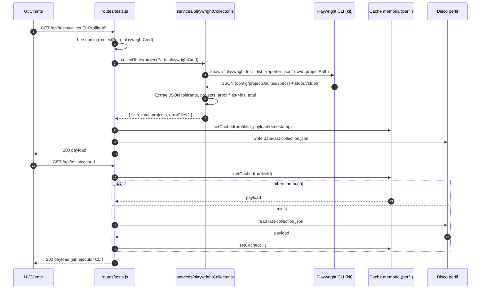
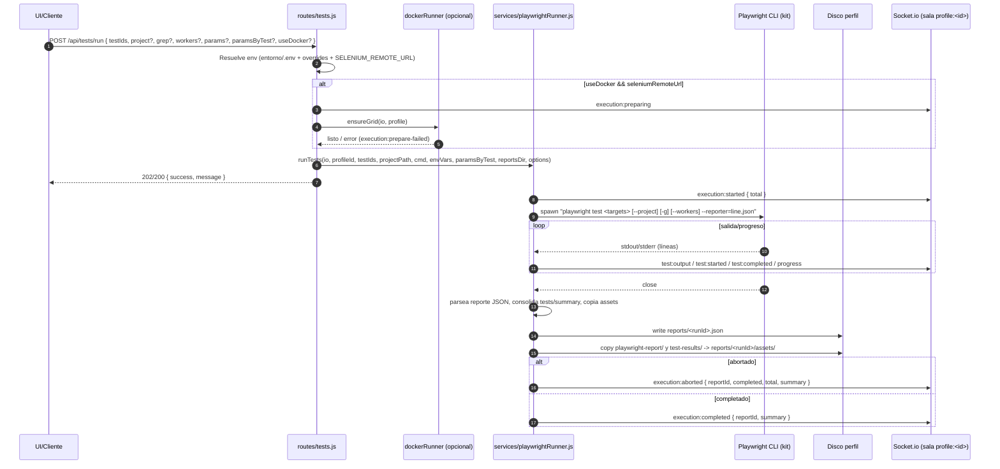
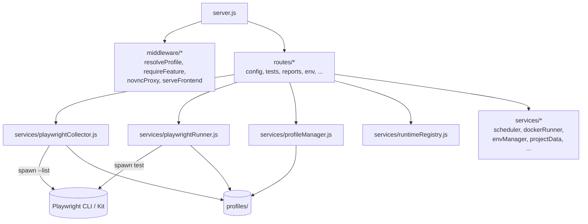
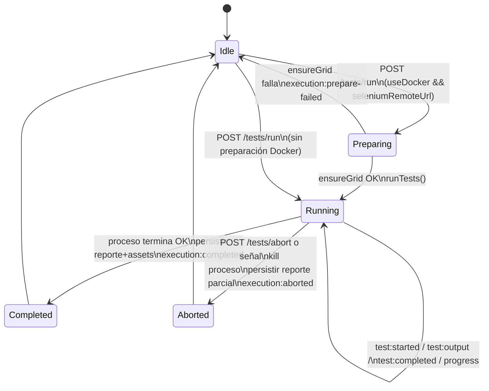

# RunLab Agrimpex — API

Backend del dashboard QA **RunLab Agrimpex**. Expone una **API REST** y un canal **Socket.io** para: gestionar perfiles/proyectos, colectar y ejecutar tests de automatización (base actual: **Playwright**), transmitir progreso en vivo y persistir reportes/artefactos.

> **Origen:** adaptación de [QADash backend](https://github.com/hramses1/dash-backend) (MIT, © hramses1). Se mantiene la filosofía de trabajo por perfiles y el contrato REST + Socket.io, adaptado al ecosistema Playwright de Agrimpex.  
> **Frontend hermano:** `runlab-agrimpex-ui` (React/Vite), servido por este backend en producción.  
> **Kit objetivo (AUT/suite):** `playwright-kit-profesional` (suite E2E Playwright; p.ej. 4 projects `chromium`, `inbond`, `air-freight`, `logistic`).

---

## Índice
- [Estado actual](#estado-actual)
- [Arquitectura rápida](#arquitectura-rápida)
- [Requisitos](#requisitos)
- [Puesta en marcha](#puesta-en-marcha)
- [Configuración](#configuración)
- [Conceptos clave (onboarding)](#conceptos-clave-onboarding)
- [Estructura del proyecto](#estructura-del-proyecto)
- [API REST (resumen)](#api-rest-resumen)
- [Eventos Socket.io](#eventos-socketio)
- [Datos en disco](#datos-en-disco)
- [Pruebas y desarrollo](#pruebas-y-desarrollo)
- [Seguridad](#seguridad)
- [Solución de problemas](#solución-de-problemas)
- [OpenSpec y convenciones](#openspec-y-convenciones)
- [Licencia](#licencia)

---

## Estado actual

- **Runner de tests:** migrado a Playwright (`services/playwrightCollector.js`, `services/playwrightRunner.js`) con paridad de contrato de eventos (`execution:*`, `test:*`, `progress`) y persistencia de reportes/assets. Colecta con `npx playwright test --list --reporter=json`, ejecuta con `npx playwright test ... --reporter=line,json`.
- **Compatibilidad:** `playwrightCmd` es el campo preferido; `pytestCmd` se mantiene **deprecado** con lectura tolerante (rutas/scheduler/config). Existen módulos legacy `pytestRunner.js`/`testCollector.js` para compatibilidad con pruebas/consumidores históricos.
- **Validación:** colección verificada contra el kit real (ej.: 713 tests, 93 archivos, 4 projects); suite del backend **27/27** en `node --test`. La ejecución E2E completa depende de que el AUT (`localhost:5000` / `localhost:8990`) esté disponible.
- **Detalles de verificación:** `openspec/changes/playwright-runner/README.md` y `openspec/changes/playwright-runner/tasks.md`.

---

## Arquitectura rápida

```
runlab-agrimpex-ui (React, dev :5173 / dist en prod)
        │  HTTP /api  +  Socket.io (/socket.io)
        ▼
runlab-agrimpex-api (Express + Socket.io, :3001)
        │
        ├─ Perfiles (workspace por proyecto) ──► profiles/<id>/...
        ├─ Collector (Playwright --list) ─────► árbol de tests + caché
        ├─ Runner (Playwright test) ──────────► eventos en vivo + reportes/assets
        └─ Módulos opcionales: env, reports, docker, schedules, data, errors, automation, system
                │
                ▼
      Proyecto de automatización (kit Playwright)  ──►  AUT (Angular :5000 / API :8990)
```

- **Multi-perfil:** cada request API (salvo admin de perfiles/sistema) se resuelve con `X-Profile-Id` (`middleware/resolveProfile.js`) y opera sobre el workspace de ese perfil.
- **Tiempo real:** el cliente se une a la sala `profile:<id>` (`profile:join`) y recibe solo eventos de ese perfil.
- **Producción:** el backend puede servir el build del frontend (`middleware/serveFrontend.js`, configurable por `QADASH_DIST_DIR`).

---

## Requisitos

| Herramienta | Uso | Obligatoria |
|---|---|---|
| Node.js 18+ | Ejecutar API y tooling | Sí |
| npm | Dependencias y scripts | Sí |
| Git | Operaciones de automatización/actualización (según uso) | Recomendada |
| Proyecto Playwright (kit) + `npx playwright`/Node deps del kit | Colección y ejecución | Sí para correr tests |
| AUT disponible (p.ej. `localhost:5000` y `localhost:8990`) | Ejecución E2E real | Sí para runs reales |
| Docker + Docker Compose | Grid Selenium / flujos dockerizados (opcional) | No |
| Python/venv/pytest | Solo para flujos legacy de automatización heredados | No (según escenario) |

> El backend **no** incluye la suite de tests: apunta a un `projectPath` (kit Playwright) configurado por perfil.

---

## Puesta en marcha

### 1) Instalar dependencias
```bash
cd runlab-agrimpex-api
npm install
```

### 2) Ejecutar
```bash
# Desarrollo (recarga con nodemon)
npm run dev

# Producción/simple
npm start
```
- Puerto por defecto: **`3001`** (`PORT` para cambiar).
- Al iniciar: aplica migración/bootstrap de perfiles (`services/profileMigration.js`) y crea **"Perfil 1"** si no existe ninguno.

### 3) Uso con el frontend
- **Dev UI:** en `runlab-agrimpex-ui` → `npm run dev` (Vite `:5173`) con proxy de `/api` y `/socket.io` a `:3001`.
- **Prod:** construir la UI (`npm run build`) y servir `dist` desde este backend (ver `QADASH_DIST_DIR`).

### 4) Smoke test rápido
```bash
# Perfil/admin
curl http://localhost:3001/api/profile-admin

# Config del perfil activo/indicado
curl -H "X-Profile-Id: perfil-1" http://localhost:3001/api/config
```

---

## Configuración

### Variables de entorno (backend)

| Variable | Default | Descripción |
|---|---|---|
| `PORT` | `3001` | Puerto HTTP/WS |
| `QADASH_DATA_DIR` | raíz del backend | Directorio base de datos runtime (perfiles/reportes) |
| `QADASH_DIST_DIR` | `../qadash-frontend/dist` | Ruta del build del frontend a servir (ajustar al proyecto actual si aplica) |
| `QADASH_FRONTEND_DIR` | `../qadash-frontend` | Repo frontend (auto-update) |
| `QADASH_NOVNC_HOST` | `127.0.0.1` | Host noVNC (proxy) |
| `QADASH_NOVNC_PORT` | `7900` | Puerto noVNC |
| `UPDATE_TOKEN` | *(vacío)* | Token para `/api/system/update` (sin él, el endpoint queda deshabilitado/503) |

> Si cambias `PORT`, alinea el proxy de la UI (`runlab-agrimpex-ui/vite.config.ts`).

### Configuración por perfil (`profiles/<id>/config.json`)

| Campo | Descripción |
|---|---|
| `projectPath` | Ruta absoluta al proyecto de automatización (kit Playwright) |
| `envPath` | Ruta al `.env` del proyecto |
| `playwrightCmd` | Comando base Playwright (recomendado, ej. `npx playwright`) |
| `pytestCmd` | **Deprecado** (compatibilidad/tolerancia legacy) |
| `seleniumRemoteUrl` | URL de Selenium/Grid remoto (opcional; se inyecta como `SELENIUM_REMOTE_URL`) |
| `txtFolderPath` | Carpeta de datos `.txt` (módulo `txtData`) |
| `jsonDataPath` | Carpeta de datos JSON (módulo `jsonData`) |
| `errorImagesPath` | Carpeta de evidencias de error (módulo `errorImages`) |

Ejemplos de referencia: `config.example.json`, `automation-config.example.json`.

---

## Conceptos clave (onboarding)

### 1) Perfil (`profile`)
Workspace aislado para un proyecto/equipo de pruebas. Contiene configuración, entornos, flags, schedules, colección cacheada y reportes.
- **Identidad:** `id` (slug) y `name` (p.ej. `perfil-1`, "Perfil 1").
- **Selección:** header `X-Profile-Id` en `/api/*` (excepto rutas de administración global de perfiles y sistema, montadas antes de `resolveProfile`).
- **Aislamiento:** estado de ejecución, caché y eventos Socket.io por perfil; varios perfiles pueden operar sin pisarse.
- **Gestión:** `services/profileManager.js`, rutas `/api/profile-admin` (listar/crear/renombrar/activar/duplicar/borrar).

#### Ejemplos prácticos de perfiles

1. **Separar entornos/configuraciones del mismo proyecto**  
   Tienes el mismo kit de pruebas, pero quieres ejecutarlo con distintas variables (URLs, credenciales, flags).
   - **Perfil A:** `qa-mariel`
     - `config.json`: `projectPath=/.../playwright-kit-profesional`, `playwrightCmd="npx playwright"`
     - `entornos.json` / `.env`: `BASE_URL=http://localhost:5000`, `API_URL=http://127.0.0.1:8990`
   - **Perfil B:** `staging`
     - Mismo `projectPath`, pero otras variables (otro `BASE_URL`, usuarios, etc.)  
   **Resultado:** cada perfil guarda sus propios reportes, colección cacheada y schedules. Ejecutas contra QA o contra Staging sin reconfigurar todo cada vez (solo cambias de perfil).

2. **Aislar equipos o alcances con feature flags**  
   Un perfil puede activar solo los módulos que necesita.
   - **Perfil:** `equipo-importaciones`
     - `features.json`: `{"reports": true, "schedules": true, "docker": false, "txtData": true, ...}`
     - Enfocado en correr suites/reportes de importación, sin exponer/usar Docker o datos JSON si no hacen falta.  
   **Resultado:** la UI y las rutas responden según el perfil (módulos apagados → 403/ocultos), evitando ruido y accesos innecesarios.

3. **Dos ejecuciones en paralelo sin mezclar eventos**  
   Quieres lanzar pruebas en dos contextos a la vez.
   - Cliente 1 (monitorizando `perfil-1`): se conecta a Socket.io y emite `profile:join` con `"perfil-1"` → recibe eventos de la sala `profile:perfil-1`.
   - Cliente 2 (monitorizando `perfil-2`): `profile:join` con `"perfil-2"` → recibe eventos de `profile:perfil-2`.
   - Llamadas REST:
     - `POST /api/tests/run` con header `X-Profile-Id: perfil-1`
     - `POST /api/tests/run` con header `X-Profile-Id: perfil-2`  
   **Resultado:** cada sala recibe solo sus `execution:*`, `test:*`, `progress`, etc. Los logs, el estado (`running`) y los reportes se guardan en `profiles/perfil-1/...` y `profiles/perfil-2/...` por separado.

4. **Duplicar para probar cambios sin riesgo**  
   Antes de cambiar configuración o comando de ejecución, clonas el perfil.
   - **Original:** `agrimpex-base` (estable)
   - **Duplicado:** `agrimpex-experimento` (copiado desde el original)  
   En el duplicado cambias, por ejemplo, `playwrightCmd`, `workers`, filtros (`--project`, `-g`) o variables de entorno, y lanzas corridas de prueba.  
   **Resultado:** comparas resultados/reportes entre perfiles; si algo sale mal, el perfil base sigue intacto (la duplicación copia config/entornos/flags/schedules, no arrastra el historial de reportes).

5. **Proyectos o kits distintos en el mismo dashboard**  
   Gestionas más de una suite de automatización.
   - **Perfil:** `agrimpex-playwright` → `projectPath=/.../playwright-kit-profesional`
   - **Perfil:** `otro-proyecto` → `projectPath=/.../otro-kit`, su propio `playwrightCmd` y variables  
   **Resultado:** un solo backend/UI centraliza ambos, pero cada perfil mantiene su colección (`last-collection.json`), sus corridas y su analítica de forma independiente. En disco se ve así:

   ```text
   profiles/
     index.json
     agrimpex-playwright/
       config.json  entornos.json  features.json  schedules.json
       data/last-collection.json
       reports/report_<id>.json
     agrimpex-experimento/
       ...
   ```

### 2) Feature flags (módulos activables)
Cada perfil define qué módulos están habilitados (`profiles/<id>/features.json`). `middleware/requireFeature.js` responde **403** si el módulo está apagado.
- Flags: `variables`, `reports`, `txtData`, `jsonData`, `errorImages`, `docker`, `schedules`.
- Siempre activos: **configuración, tests, features, profile-admin, system** (según montaje).

### 3) Colección de tests (`collector`)
Descubre los tests del proyecto Playwright sin ejecutarlos.
- **Servicio:** `services/playwrightCollector.js` → `collectTests(projectPath, playwrightCmd)`.
- **Mecanismo:** `spawn` de `playwright test --list --reporter=json` (cwd = `projectPath`), con parseo tolerante a salida no-JSON previa (dotenv, etc.).
- **Salida:** `{ files: { "<ruta>": ["<ruta>::<título>", ...] }, total, projects, errorFiles? }`.
  - **ID de test:** `<archivo_relativo>::<título jerárquico>` (estable/legible; deduplicado entre projects).
  - **Projects:** detectados desde la config/report de Playwright.
- **Caché:**
  - **Memoria:** por `profileId` (`getCached/setCached`).
  - **Disco:** `profiles/<id>/data/last-collection.json` (escrita en `GET /tests/collect`).
- **Endpoints:** `GET /api/tests/collect` (ejecuta CLI y actualiza caché), `GET /api/tests/cached` (memoria/disco, sin CLI).

### 4) Ejecución de tests (`runner`)
Orquesta corridas Playwright y emite progreso en vivo.
- **Servicio:** `services/playwrightRunner.js` → `runTests(...)`, `abortExecution(profileId)`, `isRunning(profileId)`.
- **Comando:** `npx playwright test <targets> [--project=X] [-g <filtro>] [--workers=N] --reporter=line,json` (targets derivados de los `testIds` seleccionados).
- **Selección/filtros:** `testIds` (paths o ids `archivo::título`), `project`, `grep`, `workers` (payload/opciones).
- **Entorno:** inyecta variables del perfil/proyecto (`env`/entornos guardados, `envPath`, overrides `params`/`paramsByTest`) y, si aplica, `SELENIUM_REMOTE_URL`.
- **Streaming:** eventos por sala `profile:<id>` (`execution:started`, `test:started`, `test:completed`, `test:output`, `progress`, `execution:completed|aborted|preparing|prepare-failed`).
- **Estado y concurrencia:** estado por perfil (`running/currentProc/aborted`), una ejecución activa por perfil; integrado con `runtimeRegistry`.
- **Aborto:** `POST /api/tests/abort` → termina proceso hijo (SIGTERM/taskkill) y emite `execution:aborted`.

### 5) Reportes y artefactos (`run-artifacts`)
- **Reporte JSON:** `profiles/<id>/reports/<runId>.json` con `{ id, timestamp, summary, tests[] }` (summary: total/passed/failed/errors/skipped/duration).
- **Assets Playwright:** copia de `playwright-report/` y `test-results/` del proyecto a `profiles/<id>/reports/<runId>/assets/`.
- **Servicio de assets:** `GET /api/reports/:id/assets/*` (HTML report, traces, screenshots, videos). Rutas de descarga HTML/JSON disponibles en `/api/reports/:id/download/*`.
- **Analítica:** `GET /api/reports/analytics` agrega historial y cruza con la última colección cacheada.

### 6) Entornos y variables (`variables`)
- Gestión del `.env` del proyecto y **entornos guardados** por perfil (`profiles/<id>/entornos.json`) vía `/api/env` y `/api/profiles`.
- Las variables se resuelven al ejecutar (base `.env`/entorno seleccionado + overrides de la corrida).

### 7) Runtime registry
`services/runtimeRegistry.js` registra actividades en curso por perfil y tipo (`tests`, `docker`, `install`, `pull`, `env`) y emite `profiles:status` (broadcast) para reflejar “perfil ocupado” en la UI.

### 8) Programación (scheduler)
`services/scheduler.js` evalúa `profiles/<id>/schedules.json` periódicamente y dispara ejecuciones por perfil (respetando concurrencia por perfil), con eventos `schedule:run`/`schedule:log`.

### 9) Docker / noVNC (opcional)
- `services/dockerRunner.js`, `routes/docker.js`: verificación/arranque/estado de grid (Selenium) y preparación previa a una corrida (`ensureGrid`) cuando se solicita.
- `middleware/novncProxy.js`: proxy para visualización noVNC (útil para observar el navegador remoto).

### 10) Automatización y sistema
- **Automatización (`routes/automation.js`, `services/automationInstaller.js`):** clonado/actualización de repo de pruebas, preparación de entorno/deps e instalación (flujos heredados; tolerantes a `playwrightCmd`/`pytestCmd`).
- **Sistema (`routes/system.js`, `services/selfUpdate.js`):** consulta/actualización del propio dashboard (protegido por `UPDATE_TOKEN`).

---

## Estructura del proyecto

```text
runlab-agrimpex-api/
├── server.js                 # Bootstrap Express/Socket.io, perfiles, rutas, scheduler
├── routes/                   # Endpoints por dominio (config, tests, reports, env, ...)
├── services/                 # Lógica de negocio/ejecución
│   ├── playwrightCollector.js # Colección Playwright (--list) + caché memoria
│   ├── playwrightRunner.js   # Ejecución Playwright + streaming + reportes/assets
│   ├── profileManager.js     # CRUD y paths de perfiles/entornos
│   ├── runtimeRegistry.js    # Estado "busy" por perfil/tipo
│   ├── scheduler.js          # Ejecuciones programadas
│   ├── dockerRunner.js       # Selenium/Docker (opcional)
│   ├── envManager.js         # Lectura/escritura .env
│   ├── projectData.js        # Reset de datos al cambiar proyecto
│   ├── pytestRunner.js       # Legacy (compatibilidad)
│   └── testCollector.js      # Legacy (compatibilidad)
├── middleware/               # resolveProfile, requireFeature, novncProxy, serveFrontend
├── profiles/                 # Datos runtime por perfil (gitignored en flujos típicos)
├── scripts/                  # Utilidades operativas (p.ej. auto-update.sh)
├── openspec/                 # Cambios/specs (p.ej. playwright-runner)
├── *.example.json            # Plantillas de configuración
└── *.test.js                 # Tests (node --test)
```

**Orden relevante en `server.js`:** `/api/profile-admin` y `/api/system` se montan **antes** de `resolveProfile`; el resto de `/api` pasa por resolución de perfil y, cuando aplica, por `requireFeature`; el proxy noVNC y el fallback SPA se registran al final.

---

## API REST (resumen)

Base: `http://localhost:3001/api` (salvo indicación). Rutas de perfil requieren contexto de perfil vía `X-Profile-Id` (el middleware resuelve `req.profile`).

### Perfil y sistema (sin `resolveProfile` de recursos de test)
| Método | Ruta | Descripción |
|---|---|---|
| GET/POST/PATCH/DELETE | `/profile-admin...` | Gestión de perfiles (listar, crear, renombrar, activar, duplicar, borrar) |
| GET/POST | `/system/...` | Estado/actualización del dashboard |

### Configuración y features
| Método | Ruta | Descripción |
|---|---|---|
| GET/POST | `/config` | Leer/guardar configuración del perfil |
| POST | `/config/validate` | Validar proyecto (marcadores Playwright/pytest) |
| GET | `/config/browse` | Selector nativo de archivo/carpeta |
| GET | `/config/detect-env` | Detectar `.env` en el proyecto |
| GET/POST | `/features` | Leer/guardar flags de módulos |

### Tests
| Método | Ruta | Descripción |
|---|---|---|
| GET | `/tests/collect` | Colección Playwright (`--list`) + actualiza caché (memoria/disco) |
| GET | `/tests/cached` | Última colección sin ejecutar CLI |
| POST | `/tests/run` | Ejecuta selección (`testIds`, opcional `project`, `grep`, `workers`, `params`, `paramsByTest`, `useDocker`, etc.) |
| POST | `/tests/abort` | Aborta ejecución del perfil |
| GET | `/tests/status` | Estado de ejecución (`running`) |
| GET/POST | `/tests/file` | Leer/escribir archivo dentro de `projectPath` (con protección de ruta) |

### Reportes (flag `reports`)
| Método | Ruta | Descripción |
|---|---|---|
| GET | `/reports` | Listado de ejecuciones |
| GET | `/reports/analytics` | Estadísticas agregadas |
| GET | `/reports/:id` | Detalle de reporte |
| GET | `/reports/:id/assets/*` | Assets del run (HTML report, traces, screenshots, videos) |
| GET | `/reports/:id/download/json` | Descarga JSON |
| GET | `/reports/:id/download/html` | Descarga/reporte HTML generado |
| DELETE | `/reports/:id` | Elimina reporte |

### Otros módulos (según feature flag)
| Área | Ruta base | Flag | Notas |
|---|---|---|---|
| Variables/entornos | `/env`, `/profiles` | `variables` | `.env` del proyecto y entornos guardados |
| TXT data | `/txtdata` | `txtData` | Lectura de datos de prueba `.txt` |
| JSON data | `/jsondata` | `jsonData` | Árbol/archivos/snapshots JSON |
| Docker | `/docker` | `docker` | Estado, run/stop, checks |
| Schedules | `/schedules` | `schedules` | CRUD, toggle, run manual |
| Evidencias de error | `/errors` | `errorImages` | Imágenes/capturas de fallos |
| Automatización | `/automation` | *(siempre montada)* | Check/config/install/update/branches/setup |

> Para el detalle exacto de payloads y casos borde, ver `routes/*.js` y los cambios/specs en `openspec/`.

---

## Eventos Socket.io

- **Conexión:** cliente conecta al mismo host/puerto del backend.
- **Suscripción por perfil:** emitir `profile:join` con `profileId` (y `profile:leave` para salir). El servidor emite a la sala `profile:<id>`.

| Evento | Emisor/Contexto | Descripción |
|---|---|---|
| `execution:started` | runner/tests | Inicio de corrida (`total`) |
| `execution:preparing` | tests/docker | Preparación (p.ej. grid) |
| `execution:prepare-failed` | tests/docker | Fallo de preparación |
| `test:started` | runner | Inicio de un test |
| `test:completed` | runner | Fin de un test (`status`, `duration`, `errorMsg`, `attachments`, etc.) |
| `test:output` | runner | Salida/líneas de ejecución |
| `progress` | runner | Avance agregado (`current/total/percentage`) |
| `execution:completed` | runner | Fin exitoso (`reportId`, `summary`) |
| `execution:aborted` | runner | Corrida abortada |
| `profiles:status` | runtimeRegistry | Estado global de perfiles ocupados (broadcast) |
| `schedule:run` / `schedule:log` | scheduler | Disparos y logs de programaciones |
| `docker:*` | docker | Estado/logs de contenedores |
| `automation:*` / `env:*` | automation/env | Progreso de instalación/preparación de entorno |
| `system:update` | system | Progreso de auto-actualización |

> Los payloads incluyen `profileId` cuando aplica. El contrato de eventos de ejecución se mantiene compatible con el frontend de referencia.

---

## Datos en disco

Ubicación base: `QADASH_DATA_DIR` (por defecto, la carpeta del backend).

```text
profiles/
├── index.json                     # { activeProfileId, profiles[] }
└── <profileId>/
    ├── config.json                # Configuración del proyecto/comando
    ├── automation-config.json      # Repo/ruta de automatización
    ├── features.json              # Flags de módulos
    ├── entornos.json              # Entornos/variables guardadas
    ├── schedules.json             # Programaciones
    ├── data/
    │   └── last-collection.json   # Última colección cacheada
    └── reports/
        ├── <runId>.json           # Reporte de ejecución
        └── <runId>/assets/        # Assets copiados (playwright-report/, test-results/)
```

- Los datos de `profiles/` son **runtime/locales** (no diseñados para versionarse).
- La analítica y `/tests/cached` dependen de `reports/` y de `data/last-collection.json`.

---

## Pruebas y desarrollo

```bash
# Tests del backend (runner nativo de Node)
npm test

# Modo desarrollo
npm run dev
```

- Tests ubicados junto al código (`*.test.js`), ejecutados con `node --test`.
- Estado actual esperado: **27 tests, 0 fallos**.
- Cambios planificados/activos se documentan en `openspec/` (ver `playwright-runner`).

---

## Seguridad

> **Importante:** este servicio está pensado para **red de confianza / uso interno**.

- **Sin autenticación** y **CORS abierto**.
- Ejecuta procesos/comandos del sistema (Playwright, Docker, automatización, lectura/escritura de archivos del proyecto).
- `UPDATE_TOKEN` solo protege el endpoint de actualización del sistema (y no sustituye autenticación general).
- No exponer a internet sin un proxy con autenticación, VPN u otros controles.

---

## Solución de problemas

| Síntoma | Posible causa / acción |
|---|---|
| `Project path not configured` | Falta `projectPath` en `config.json` del perfil |
| `Execution already in progress` | Ya hay una corrida activa en ese perfil; esperar o `POST /tests/abort` |
| Colección falla / `playwright test --list` no responde | Verificar `playwrightCmd`, dependencias del kit (`npm install`), config Playwright y que el comando corra en `projectPath` |
| No se generan assets HTML/traces | Depende de la configuración/reporters de Playwright y de que la corrida produzca `playwright-report/` o `test-results/` |
| 403 en un endpoint | Módulo deshabilitado en `features.json` del perfil |
| Eventos Socket.io no llegan | Confirmar `profile:join` con el `profileId` correcto y conexión al mismo backend |
| UI no carga en prod | Revisar `QADASH_DIST_DIR` y que exista el build del frontend |
| `EADDRINUSE` en `3001` | Puerto ocupado; usar `PORT=<otro>` |

---

## OpenSpec y convenciones

- **Especificaciones/cambios:** `openspec/` (p.ej. `openspec/changes/playwright-runner/` con proposal, design, specs, tasks y README de verificación).
- **Convención de nombres:** el nombre del change identifica la capability principal (sustantivo, kebab-case). Ej.: `playwright-runner` agrupa `test-collection`, `test-execution`, `run-artifacts`.
- **Contexto del repo:** `openspec/project.md` y `openspec/config.yaml`.

---

## Anexos: diagramas y ejemplos

### A.1 Resolución de perfil y módulos (request API)

```mermaid
flowchart TD
    A[Cliente HTTP] -->|X-Profile-Id| B{Ruta}
    B -->|/api/profile-admin, /api/system| C[Handler directo\n(sin resolveProfile de recursos de test)]
    B -->|/api/* resto| D[resolveProfile\nmiddleware]
    D -->|profileId válido| E[req.profile = paths del perfil]
    D -->|inválido/ausente según regla| X[400 / perfil activo]
    E --> F{requireFeature?}
    F -->|módulo activo| G[Route handler]
    F -->|módulo inactivo| H[403]
    G --> I[services + profiles/<id>/...]
```

> Nota: el orden de montaje en `server.js` importa (`profile-admin`/`system` antes de `resolveProfile`; fallback SPA y proxy noVNC al final).

### A.2 Flujo de colección de tests (`/tests/collect` y `/tests/cached`)



**Ejemplo de respuesta (colección):**
```json
{
  "timestamp": "2026-11-19T12:00:00.000Z",
  "files": {
    "login.spec.ts": [
      "login.spec.ts::Login › inicia sesión con credenciales válidas",
      "login.spec.ts::Login › muestra error con password incorrecta"
    ]
  },
  "total": 713,
  "projects": ["chromium", "inbond", "air-freight", "logistic"]
}
```

### A.3 Flujo de ejecución (`/tests/run`) y streaming



**Ejemplo de request (`POST /api/tests/run`):**
```json
{
  "testIds": [
    "login.spec.ts::Login › inicia sesión con credenciales válidas"
  ],
  "project": "chromium",
  "grep": "",
  "workers": 2,
  "params": { "BASE_URL": "http://localhost:5000" },
  "paramsByTest": {
    "login.spec.ts::Login › inicia sesión con credenciales válidas": { "RETRY": "1" }
  },
  "useDocker": false
}
```

**Eventos Socket.io (payloads ilustrativos, incluyen `profileId`):**
```json
{ "event": "execution:started", "payload": { "total": 5, "profileId": "perfil-1" } }
{ "event": "test:started", "payload": { "id": "login.spec.ts::Login › ...", "index": 0, "total": 5, "profileId": "perfil-1" } }
{ "event": "test:output", "payload": { "id": "login.spec.ts::Login › ...", "line": "...", "profileId": "perfil-1" } }
{ "event": "test:completed", "payload": { "id": "login.spec.ts::Login › ...", "status": "passed", "duration": 1.23, "output": "", "errorMsg": "", "attachments": [], "profileId": "perfil-1" } }
{ "event": "progress", "payload": { "current": 1, "total": 5, "percentage": 20, "profileId": "perfil-1" } }
{ "event": "execution:completed", "payload": { "reportId": "report_1732012345678", "summary": { "total": 5, "passed": 4, "failed": 1, "errors": 0, "skipped": 0, "duration": 42.1 }, "profileId": "perfil-1" } }
```

> El streaming en vivo se apoya en el reporter de línea y la consolidación final en el reporte JSON; el detalle/adjuntos definitivos provienen del reporte parseado.

### A.4 Modelo de reporte y assets

```mermaid
flowchart LR
    R[runTests finaliza] --> J[reports/<runId>.json]
    R --> A[reports/<runId>/assets/]
    A --> H[playwright-report/ (HTML)]
    A --> T[test-results/ (screenshots, trace.zip, videos)]
    J --> L[GET /api/reports, /api/reports/:id, analytics]
    A --> S[GET /api/reports/:id/assets/*]
```

**Ejemplo de `reports/<runId>.json` (simplificado):**
```json
{
  "id": "report_1732012345678",
  "timestamp": "2026-11-19T12:34:56.789Z",
  "summary": {
    "total": 2,
    "passed": 1,
    "failed": 1,
    "errors": 0,
    "skipped": 0,
    "duration": 12.34
  },
  "tests": [
    {
      "id": "login.spec.ts::Login › inicia sesión con credenciales válidas",
      "status": "passed",
      "duration": 3.21,
      "output": "",
      "errorMsg": "",
      "attachments": [],
      "project": "chromium"
    },
    {
      "id": "login.spec.ts::Login › muestra error con password incorrecta",
      "status": "failed",
      "duration": 9.13,
      "output": "",
      "errorMsg": "Error: expect(...)\n[flaky]",
      "attachments": [
        { "name": "trace", "contentType": "application/zip", "path": "test-results/.../trace.zip" }
      ],
      "project": "chromium"
    }
  ]
}
```

### A.5 Estructura de datos por perfil (mapa)

```mermaid
flowchart TB
    subgraph PROFILES[profiles/]
      IDX[index.json\nactiveProfileId, profiles[]]
      subgraph P[profiles/<profileId>/]
        C[config.json\nprojectPath, envPath, playwrightCmd, ...]
        F[features.json\nmódulos on/off]
        E[entornos.json]
        S[schedules.json]
        AU[automation-config.json]
        subgraph D[data/]
          LC[last-collection.json]
        end
        subgraph REP[reports/]
          RJ[<runId>.json]
          subgraph RA[<runId>/assets/]
            PR[playwright-report/]
            TR[test-results/]
          end
        end
      end
    end
    IDX --> P
    C -->|colección/ejecución| LC
    C -->|ejecución| RJ
    RJ --> RA
```

### A.6 Mapa rápido de componentes (código)



### A.7 Estados de ejecución por perfil



**Notas:**
- El estado operativo se mantiene por perfil en `services/playwrightRunner.js` (`running`, `currentProc`, `aborted`) y se refleja a nivel global mediante `runtimeRegistry` (`kind: "tests"` → evento `profiles:status`).
- `GET /api/tests/status` expone `{ running }` para el perfil resuelto.
- Una ejecución activa por perfil; intentos concurrentes sobre el mismo perfil responden `409 Execution already in progress`.

### A.8 Ejemplos de analítica (`GET /api/reports/analytics`)

La analítica agrega el historial de reportes del perfil y, si existe, lo cruza con la última colección (`data/last-collection.json`) para estimar cobertura (tests únicos ejecutados/no ejecutados).

**Ejemplo (sin datos):**
```json
{
  "totalRuns": 0,
  "totalExecutions": 0,
  "totalPassed": 0,
  "totalFailed": 0,
  "passRate": 0,
  "avgDuration": 0,
  "totalAvailable": null,
  "uniqueExecuted": 0,
  "uniquePassed": 0,
  "uniqueFailed": 0,
  "neverExecuted": null,
  "byFile": [],
  "timeline": []
}
```

**Ejemplo (con historial y colección):**
```json
{
  "totalRuns": 3,
  "totalExecutions": 18,
  "totalPassed": 14,
  "totalFailed": 4,
  "passRate": 78,
  "avgDuration": 36.7,
  "totalAvailable": 713,
  "uniqueExecuted": 12,
  "uniquePassed": 9,
  "uniqueFailed": 3,
  "neverExecuted": 701,
  "byFile": [
    {
      "file": "login.spec.ts",
      "totalAvailable": 3,
      "uniqueExecuted": 3,
      "uniquePassed": 2,
      "uniqueFailed": 1,
      "neverExecuted": 0,
      "aggregatePassed": 5,
      "aggregateFailed": 1,
      "aggregateTotal": 6
    },
    {
      "file": "cenasa-basic.spec.ts",
      "totalAvailable": 10,
      "uniqueExecuted": 4,
      "uniquePassed": 4,
      "uniqueFailed": 0,
      "neverExecuted": 6,
      "aggregatePassed": 4,
      "aggregateFailed": 0,
      "aggregateTotal": 4
    }
  ],
  "timeline": [
    {
      "timestamp": "2026-11-19T10:05:00.000Z",
      "passed": 4,
      "failed": 1,
      "total": 5,
      "passRate": 80
    },
    {
      "timestamp": "2026-11-19T11:20:00.000Z",
      "passed": 5,
      "failed": 2,
      "total": 7,
      "passRate": 71
    }
  ]
}
```

**Campos clave:**
- `passRate` / `unique*` / `neverExecuted`: basados en el **último estado conocido por test** (el estado más reciente gana) y, si hay colección, en `totalAvailable`.
- `byFile`: mezcla métricas agregadas por ejecuciones (`aggregate*`) y métricas únicas por test (`unique*`, `neverExecuted`) a nivel de archivo.
- `timeline`: serie cronológica por corrida (`passed/failed/total/passRate` y `timestamp`).

---

## Licencia

MIT. Incluye/adapta componentes con licencia MIT de QADash (© hramses1); ver cabeceras y archivos de licencia correspondientes.
